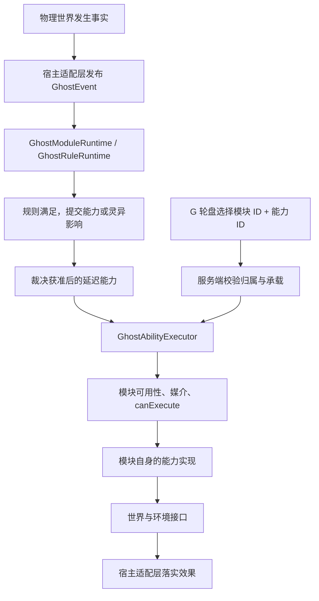

# 厉鬼模块开发指南：从零构建一只完整的厉鬼

适用版本：本文按 2026-11-14 当前仓库实现编写，Minecraft 1.21.1 / NeoForge / Java 21。

本文同时说明**当前实现**与**新模块应遵循的约定**，不把尚未提供的宿主能力当成已经实现的功能。示例完整源文件见 [ContactEchoModule.java](examples/ContactEchoModule.java)，它属于文档示例，不会自动注册到游戏。

## 阅读路线

1. [模块到底是什么](#1-模块到底是什么)
2. [当前能力定义与执行链](#2-当前能力定义与执行链)
3. [先设计规则、媒介、能力](#3-先设计规则媒介能力)
4. [完整示例：触响鬼](#4-完整示例触响鬼)
5. [注册、语言与图标](#5-注册语言与图标)
6. [让不同宿主携带模块](#6-让不同宿主携带模块)
7. [实例状态与存档](#7-实例状态与存档)
8. [语义事件与调用参数](#8-语义事件与调用参数)
9. [扩展接口与特殊能力](#9-扩展接口与特殊能力)
10. [灵异裁决与复苏代价](#10-灵异裁决与复苏代价)
11. [调试、测试与常见问题](#11-调试测试与常见问题)
12. [现阶段边界与发布清单](#12-现阶段边界与发布清单)

## 1. 模块到底是什么

**一个 `GhostModule` 代表一只完整的厉鬼。** 同一只厉鬼可以有多个规则、多个媒介和多个独立能力。不要给同一只鬼的每个技能分别创建一个模块。

例如鬼签是一个模块，活签、死签、鬼签是三个能力；开门鬼和关门鬼则是两个模块。

| 概念 | 职责 | 示例 |
| --- | --- | --- |
| 模块定义 `GhostModule` | 描述整只厉鬼、初始属性、规则、技能、承载形式 | 鬼寿衣、鬼签 |
| 实例 `GhostModuleData.Entry` | 保存当前强度、复苏、沉睡、死机、专属数据 | 玩家身上的这一只鬼签 |
| 规则 `GhostRule` | 决定何时自动发起能力或影响 | 接触开始、声音中断、受到袭击 |
| 媒介 `GhostMedium` | 无论哪个渠道调用，都必须满足的条件 | 正在接触、暴露在世界、覆盖表面 |
| 能力 `GhostAbility` | 一项具体技能的条件、元数据和世界效果 | 发动袭击、开关鬼域 |
| 语义事件 `GhostEvent` | 描述已经发生、经过采集确认的事实 | `TouchEvent` |
| 调用参数 `GhostAbilityParameters` | 描述一次操作所需的输入 | 指定目标、指定门 |
| 宿主与适配层 | 存数据、采集事实、实现世界操作 | 玩家、实体、物品、方块 |

### 最重要的边界

模块不判断自己由谁承载，也不取得宿主后再向下转型。

模块可以使用：

```java
context.getModuleContext().world();
context.getModuleContext().environment();
context.getModuleContext().targetState();
```

模块中不要使用：

```java
context.host();                         // 不取得宿主对象
// instanceof PlayerGhostModuleHost    // 不判断宿主类型
// new GhostItemModuleHost(...)        // 不创建宿主适配器
// GhostModuleHosts.living(...)        // 不绕路取回宿主实体
```

事件或参数中的目标实体是世界作用对象。允许处理目标，不等于允许查询模块自身的宿主。不要把 `GhostInvocationParameters.recipient()` 当作“获取宿主”的后门。

`Source.RULE / BEHAVIOR / POSSESSION` 表示调用来源，可以用于解释复苏代价；它不是宿主类型，不应被用来推断“这个宿主一定是玩家”。

模块定义在注册表中复用。`static final` 常量、不可变能力列表可以保存在定义里；某个实例的目标、冷却和成长值不能放进定义对象或全局静态字段。

## 2. 当前能力定义与执行链

### 2.1 唯一能力列表

新模块覆盖 `getIntrinsicAbilities()`：

```java
@Override
public List<GhostAbility> getIntrinsicAbilities() {
    return List.of(new FirstAbility(), new SecondAbility());
}
```

当前 `getAbilities()` 默认返回该列表的不可变副本。开发新模块不应另外覆盖它来维护第二份技能目录。

以下旧机制已经移除，不要重新引入：

- `getActiveAbilities()` 与主动技能白名单。
- `manuallySelectable()` 过滤。
- `GhostActiveAction` 预设技能枚举。
- `WorldActionAbility` 与集中式动作分发。
- 每个模块自动附加的 `player_action`。

**声明的能力都会进入统一能力目录。** 轮盘取玩家已经驾驭、满足承载条件的模块，按实例保存顺序、能力声明顺序取前十项。超过十项只是不显示在当前轮盘，完整目录仍保留它们；自定义排序界面目前还没有实现。

寻路更新、冷却递减、鬼域资源维护、持续代价计时等内部工作，不要仅为复用执行器而注册成技能。

### 2.2 一个能力需要定义什么

| 方法 | 当前默认值 / 用法 |
| --- | --- |
| `getId()` | 必须实现；模块内唯一且长期稳定 |
| `translationKey()` | `ability.<namespace>.<path>`，路径中的 `/` 替换为 `.` |
| `iconTexture()` | 默认原版下界之星；建议显式声明完整 PNG 路径 |
| `media(context)` | 默认空；能力自己的硬性媒介 |
| `inheritsModuleMedia()` | 默认 `true`；同时检查模块媒介 |
| `canExecute(context)` | 必须实现；只判断，不改变状态 |
| `execute(context)` | 必须实现；兼容无返回结果调用 |
| `executeWithResult(context)` | 默认调用 `execute()` 后返回 `true`；真实效果可能失败时应覆盖 |
| `getStimulation(context)` | 默认无复苏刺激；代价声明见第十节 |

媒介组合方式：

```text
模块 getMedia(context)（仅在 inheritsModuleMedia 为 true 时）
    + 当前能力 media(context)
    → 所有媒介都通过
    → canExecute
    → 复苏刺激与效果执行
```

共享条件放模块媒介；某一个技能的条件放技能媒介。不要把“必须开着鬼域”写成整个模块的共用条件，导致“打开鬼域”自身无法使用。

`inheritsModuleMedia() == false` 是完全替换模块共用媒介，不是忽略所有条件。使用它时必须说明为什么这个技能不适用模块共用条件，并完整声明自己的前提。

### 2.3 两种实现写法

复杂技能推荐普通类或匿名 `GhostAbility`，便于分别声明媒介、代价和成功结果。

简单技能可以使用 `DefinedGhostAbility`：

```java
new DefinedGhostAbility(
        ResourceLocation.fromNamespaceAndPath("qisplan2", "example/domain_up"),
        ResourceLocation.parse("minecraft:textures/item/glowstone_dust.png"),
        c -> c.getModuleContext().world().domain().exists()
                && c.getModuleContext().world().domain().layer() < 6,
        c -> c.getModuleContext().world().domain().setLayer(
                c.getModuleContext().world().domain().layer() + 1)
)
```

需要导入 `DefinedGhostAbility` 和 `ResourceLocation`。这是用法片段，不是需要新增的全局注册项。

该 record 仅保存模块传入的条件和效果函数，没有预设技能、技能 ID 分发或宿主分支。它仍继承模块媒介；需要自定义刺激或能力专属媒介时，改用普通 `GhostAbility`。

### 2.4 实际执行流程



规则和轮盘最终调用的是同一个能力 ID、同一份实现。轮盘不会自动生成 `TouchEvent`、`DoorChangedEvent` 或“受到袭击”事实。

### 2.5 状态限制的准确含义

`RULE`、`BEHAVIOR` 要求模块满足 `GhostModuleCombatState.available()`；承载失败、沉睡、死机等会使其不可用。

当前 `GhostAbilityContext.isModuleAvailable()` 对 `POSSESSION` 的实现，是检查模块存在且可承载，然后绕过整个 `available()` 检查。因此当前代码不只是绕过裁决死机，也绕过该检查包含的沉睡、普通和永久死机状态。若未来要单独限制主动调用时的沉睡行为，需要修改统一策略，不能在各技能里悄悄添加宿主分支。

这不意味着主动技能无条件成功：媒介、目标资格、能力条件、世界接口支持范围仍然有效。

## 3. 先设计规则、媒介、能力

先写设计表，再写类。本文的教学模块叫“触响鬼”：

| 项目 | 定义 |
| --- | --- |
| 模块 ID | `qisplan2:contact_echo` |
| 初始属性 | 强度 10，复苏 0 |
| 形式 | 独立式，使用框架默认值 |
| 规则 | 开始接触一个存活目标时，尝试发动袭击 |
| 媒介 | 具有有效接触目标 |
| 能力 | `qisplan2:contact_echo/contact_attack` |
| 主动输入 | 服务端视线目标或可信调用参数；仍要验证当前确实接触 |
| 复苏代价 | 实际击杀成功时增加 1 点复苏 |
| 持久状态 | 本例不需要额外状态 |
| 世界效果 | 调用 `world.attack()` |

“开始接触”是自动触发规则；“正在接触”是硬性媒介。主动调用可以越过前者，不能越过后者。

如果设计的是“累计接触十五秒才自动袭击”，累计时间应放规则及关系状态中。不要让主动袭击也必须先积攒十五秒，除非你确实希望十五秒成为所有渠道共用的能力前提。

## 4. 完整示例：触响鬼

将示例复制到：

```text
src/main/java/com/qidate/qisplan2/ghost/module/implementation/example/ContactEchoModule.java
```

示例只复用已有接口和资源，不新增实体类、不新增按键、不新增技能网络包。它不会通过 `customData` 修改不可变宿主，因此同一能力也能使用静态来源提供的接触事实。

```java
package com.qidate.qisplan2.ghost.module.implementation.example;

import com.qidate.qisplan2.death.ModDamageTypes;
import com.qidate.qisplan2.ghost.module.GhostMedium;
import com.qidate.qisplan2.ghost.module.GhostModule;
import com.qidate.qisplan2.ghost.module.GhostRule;
import com.qidate.qisplan2.ghost.module.GhostRuleContext;
import com.qidate.qisplan2.ghost.module.ability.GhostAbility;
import com.qidate.qisplan2.ghost.module.ability.GhostAbilityContext;
import com.qidate.qisplan2.ghost.module.ability.GhostAbilityStimulation;
import com.qidate.qisplan2.ghost.module.ability.GhostTargetParameters;
import com.qidate.qisplan2.ghost.module.data.GhostModuleInitialData;
import com.qidate.qisplan2.ghost.module.event.GhostEvent;
import com.qidate.qisplan2.ghost.module.event.TouchEvent;
import com.qidate.qisplan2.ghost.module.influence.GhostInfluenceCollector;
import com.qidate.qisplan2.ghost.module.influence.GhostInfluenceType;
import java.util.List;
import net.minecraft.resources.ResourceLocation;
import net.minecraft.world.entity.LivingEntity;

/**
 * 教学模块：触响鬼。
 * 规则：开始接触时尝试袭击；媒介：存在有效接触目标；能力：接触袭击。
 * 定义不持有任何宿主对象或单个实例的可变状态。
 */
public final class ContactEchoModule implements GhostModule {
    public static final ResourceLocation ID = id("contact_echo");
    public static final ResourceLocation ATTACK = id("contact_echo/contact_attack");
    private static final ResourceLocation RULE = id("contact_echo/contact_begin");
    private static final ResourceLocation MEDIUM = id("contact_echo/contact");
    private static final ResourceLocation ICON =
            ResourceLocation.parse("minecraft:textures/item/iron_sword.png");
    private static final List<GhostAbility> ABILITIES = List.of(new ContactAttack());
    private static final List<GhostRule> RULES = List.of(new ContactRule());

    /** 所有定义标识使用模块所在命名空间。 */
    private static ResourceLocation id(String path) {
        return ResourceLocation.fromNamespaceAndPath("qisplan2", path);
    }

    /** 返回整只厉鬼的唯一身份。 */
    @Override public ResourceLocation getId() { return ID; }

    /** 只影响新建实例，不覆盖存档中的实时属性。 */
    @Override public GhostModuleInitialData getInitialData() {
        return new GhostModuleInitialData(10, 0);
    }

    /** 教学示例不自动增长复苏；能力成功时单独结算刺激。 */
    @Override public double getNaturalRevivalRate() { return 0; }

    /** 模块图标与技能图标分别声明，即使本例复用同一纹理。 */
    @Override public ResourceLocation iconTexture() { return ICON; }

    /** 规则只是自动调用入口。 */
    @Override public List<GhostRule> getRules() { return RULES; }

    /** 唯一技能列表；自动规则和轮盘均使用这里的同一能力。 */
    @Override public List<GhostAbility> getIntrinsicAbilities() { return ABILITIES; }

    /** 本例只有一个技能，接触条件作为模块共用媒介。 */
    @Override public List<GhostMedium> getMedia() {
        return List.of(new GhostMedium() {
            /** 媒介 ID 与规则、能力 ID 分开命名。 */
            @Override public ResourceLocation getId() { return MEDIUM; }

            /** 仅检查条件，不支付代价、不改变世界。 */
            @Override public boolean allows(GhostAbilityContext context) {
                return contactTarget(context) != null;
            }
        });
    }

    /**
     * 自动调用使用可信接触事实；直接调用使用输入目标或世界视线。
     * 主动调用不能凭空制造接触，必须由世界接口再次验证实际接触关系。
     * 静态来源的 TouchEvent.source 可以为空，因此不把它当作必须存在的实体。
     */
    private static LivingEntity contactTarget(GhostAbilityContext context) {
        if (context.event() instanceof TouchEvent event) {
            LivingEntity target = event.target();
            return target.isAlive() && !target.level().isClientSide() ? target : null;
        }
        var world = context.getModuleContext().world();
        LivingEntity target = context.parameters() instanceof GhostTargetParameters input
                ? input.target() : world.aimedTarget(3);
        return target != null && target.isAlive() && !target.level().isClientSide()
                && world.touching(target) ? target : null;
    }

    /** 开始接触是自动触发条件；持续接触不重复触发本规则。 */
    private static final class ContactRule implements GhostRule {
        /** 返回规则标识。 */
        @Override public ResourceLocation getId() { return RULE; }

        /** 只订阅真正的接触语义事实。 */
        @Override public boolean supports(GhostEvent event) {
            return event instanceof TouchEvent;
        }

        /** 自动规则要求接触刚发生；这一条件不限制主动技能。 */
        @Override public boolean canTrigger(GhostRuleContext context, GhostEvent event) {
            return event instanceof TouchEvent touch && touch.isBeginning()
                    && touch.target().isAlive() && !touch.target().level().isClientSide();
        }

        /** 收集同目标保护诅咒，再提交袭击影响，裁决获准后才执行能力。 */
        @Override public void onTrigger(GhostRuleContext context, GhostEvent event) {
            var target = ((TouchEvent) event).target();
            var server = target.getServer();
            if (server == null) return;
            GhostInfluenceCollector.collectCurses(context, target.getUUID(), server);
            context.submitAbilityInfluence(ATTACK, event, target.getUUID(),
                    GhostInfluenceType.ATTACK, context.getModuleContext().effectiveIntensity());
        }
    }

    /** 真正的技能实现；这里不认识实体宿主、玩家宿主或物品宿主。 */
    private static final class ContactAttack implements GhostAbility {
        /** 返回技能 ID，语言键默认由它推导。 */
        @Override public ResourceLocation getId() { return ATTACK; }

        /** 返回完整纹理资源路径。 */
        @Override public ResourceLocation iconTexture() { return ICON; }

        /** 重检目标，防止延迟执行时继续使用已失效对象。 */
        @Override public boolean canExecute(GhostAbilityContext context) {
            return contactTarget(context) != null;
        }

        /** 每次实际击杀成功增加一点复苏，由执行器统一结算。 */
        @Override public GhostAbilityStimulation getStimulation(GhostAbilityContext context) {
            return new GhostAbilityStimulation(1,
                    GhostAbilityStimulation.Timing.ON_EFFECT_SUCCESS);
        }

        /** 兼容不需要效果返回值的调用者。 */
        @Override public void execute(GhostAbilityContext context) {
            executeWithResult(context);
        }

        /** 通过抽象世界接口发动袭击，并返回真实结果。 */
        @Override public boolean executeWithResult(GhostAbilityContext context) {
            LivingEntity target = contactTarget(context);
            if (target == null) return false;
            var module = context.getModuleContext();
            // 教学示例复用不可触之鬼伤害类型；正式发布时可注册独立伤害类型与死亡译文。
            return module.world().attack(target, ModDamageTypes.UNTOUCHABLE_GHOST,
                    module.effectiveIntensity());
        }
    }
}
```

### 示例的重要取舍

- 自动调用由可信采集层提供 `TouchEvent`，不要求静态来源必须有实体形态。
- 主动调用会重新验证物理接触，视线命中本身不等于接触。
- `GhostTargetParameters` 仅供服务端或内部可信调用者使用；当前轮盘包不接受客户端指定的目标 UUID。
- 定义不保存实例状态，多个宿主共享定义不会共享冷却或目标。
- 本例复用 `UNTOUCHABLE_GHOST` 伤害类型，所以死亡消息也沿用该类型。正式发布可增加自己的伤害类型及数据资源；不要只改字符串而漏掉伤害类型注册。
- `world.attack()` 返回真实袭击结果；本例 `ON_EFFECT_SUCCESS` 表示击杀成功才结算一点复苏，不是“按下技能就收费”。

## 5. 注册、语言与图标

### 5.1 注册模块一次

在 `GhostModuleRegistry.bootstrap()` 增加：

```java
register(new ContactEchoModule());
```

并添加导入：

```java
import com.qidate.qisplan2.ghost.module.implementation.example.ContactEchoModule;
```

重复注册相同模块 ID 会抛异常。注册表保存定义，不能为每个玩家注册一次。

### 5.2 添加中英文语言键

合并到 `src/main/resources/assets/qisplan2/lang/zh_cn.json`：

```json
{
  "module.qisplan2.contact_echo": "触响鬼",
  "ability.qisplan2.contact_echo.contact_attack": "触响袭击"
}
```

合并到 `en_us.json`：

```json
{
  "module.qisplan2.contact_echo": "Contact Echo Ghost",
  "ability.qisplan2.contact_echo.contact_attack": "Contact Echo Strike"
}
```

以上是要加入的键，不要覆盖整个语言文件。模块名称用 `module.*`，技能名称用 `ability.*`，二者是不同层次。

技能 ID `qisplan2:contact_echo/contact_attack` 默认推导出 `ability.qisplan2.contact_echo.contact_attack`。不要把资源 ID 对象直接当作 `Component.translatable` 的格式参数；需要显示 ID 时转换成字符串。

### 5.3 自定义图标

本例使用原版纹理，无需新增资源。自定义图标例如：

```java
ResourceLocation.parse("qisplan2:textures/gui/ability/contact_echo.png")
```

对应文件：

```text
src/main/resources/assets/qisplan2/textures/gui/ability/contact_echo.png
```

这是完整纹理路径，不是物品注册 ID，也不是模型 ID。技能图标应返回非空资源位置；模块卡片的 `GhostModule.iconTexture()` 允许为空，不代表技能图标也可以为空。

### 5.4 自动进入轮盘

玩家实际驾驭并成功承载该模块后，`GhostAbilityCatalog` 自动收集其能力。无需修改 `ClientKeyHandler`、`GhostAbilityNetwork` 或新增专用技能包。

当前交互：按住 G 打开，鼠标悬停选择，松键或左键提交，中心/外部/Esc 取消。扇区显示图标和技能名称，中央显示选中的完整名称与所属模块。

## 6. 让不同宿主携带模块

注册定义并不等于世界里已经出现了这只鬼。还需要安装实例或配置默认实例。

### 6.1 玩家与调试命令

在具有相应权限的开发环境中：

```text
/qisplan2 module list
/qisplan2 possess qisplan2:contact_echo
/qisplan2 module player info
/qisplan2 release qisplan2:contact_echo
```

`/qisplan2 module player` 当前提供查询入口，不要写成不存在的 `module player add` 命令。正常玩法的驾驭由统一驾驭流程完成，不为新模块另建 possession ability。

### 6.2 通用实体宿主

普通厉鬼使用 `ModularGhostEntity` 携带模块。只有确实需要独特物理模型或宿主组成时，才创建继承该通用类的实体。

自定义实体构造器可调用：

```java
super(type, level, composition,
        List.of(new GhostModuleData.Entry(ContactEchoModule.ID, 10, 0)));
```

这是构造器内的片段，`type / level / composition` 由具体实体提供。无需为每种规则重建一个专用实体行为类；缺少的物理行为应在适配层实现。

新增实体类型仍需正常注册属性、渲染器等宿主资源。注册模块本身不会完成这些 Minecraft 实体注册工作。

### 6.3 普通物品与剑

普通模块物品可继承 `GhostModuleItem`。默认模块通过数据组件设置：

```java
properties.component(
        ModDataComponents.GHOST_MODULES.get(),
        List.of(new GhostModuleData.Entry(ContactEchoModule.ID, 10, 0))
)
```

参考 `GhostDivinationSlipItem` 的实际构造方式。这个表达式用于物品属性配置，不需要把数据再写一份到模块定义中。

Java 不支持同时继承 `SwordItem` 和 `GhostModuleItem`。需要保留剑父类时实现 `GhostModuleItemSupport`，再正确转交 `useModules`、`tickModules` 等生命周期入口。

给现有物品安装模块可用：

```text
/qisplan2 module item add qisplan2:contact_echo
/qisplan2 module item info
/qisplan2 module item remove qisplan2:contact_echo
```

给物品添加实例与采集物理事实是两件事。普通右键物品入口发出的是 `GhostUseEvent`，不会自动变成接触规则；示例需要现有接触采集入口或为该物品补齐对应事实采集。

### 6.4 静态方块宿主

`StaticBlockModuleHost` 适合模块配置固定、无需逐方块保存实例状态的方块：

```java
new StaticBlockModuleHost(ContactEchoModule.ID, 10);
```

宿主适配或方块接触采集代码在服务端确认接触后分发：

```java
GhostModuleRuntime.dispatch(host, TouchEvent.sample(null, target, beginning));
```

`host / target / beginning` 由采集层取得。`beginning` 必须来自真实的进入/离开检测，不能每 tick 一律传 `true`，否则“开始接触”规则会每 tick 重复触发。

静态宿主没有实体形体，也不一定保存自身世界坐标。能力不能为了工作而强制向它索取实体来源。本例使用可信接触事件里的目标，并把实际袭击交给世界接口。

### 6.5 承载形式与侵蚀

默认独立式不占承载部位。替换式例如：

```java
@Override
public GhostModuleForm form() {
    return GhostModuleForm.replacing(SpiritualPart.SKIN);
}
```

侵蚀独立声明：

```java
@Override
public GhostCorrosion corrosion() {
    return GhostCorrosion.builder()
            .add(SpiritualPart.SKIN, 60)
            .build();
}
```

占皮肤与侵蚀皮肤不是同一个概念。当前玩家和基础实体默认 21 个部位，`GLOBAL` 不计入承载部位；物品和方块默认万能部位。部位冲突会导致安装失败或已有旧实例失去运行资格。

详细规则见 [宿主灵异承载](ghost-bearing.md)。不要在模块里写“玩家占皮肤、物品占万能部位”的分支，匹配由承载框架负责。

## 7. 实例状态与存档

### 7.1 通用属性和专属属性分开

实例条目保存：

```text
id / intensity / revival / sleeping / deadlocked / customData
```

强度、复苏、沉睡和裁决死机不应在 `customData` 中重复保存。普通/永久死机等框架状态有自己的保留结构，例如 `qisplan2:combat`，不要覆盖它。

`getInitialData()` 只提供新建实例初始值。修改定义初始强度不会自动重置已有存档。

### 7.2 正确读写 customData

对支持模块专属数据读写的宿主，使用上下文读副本、修改、写回：

```java
var module = context.getModuleContext();
var data = module.getCustomData();
int count = Math.max(0, data.getInt("successfulUses"));
data.putInt("successfulUses", count == Integer.MAX_VALUE ? count : count + 1);
module.setCustomData(data);
```

不要只 `putInt` 而不写回，也不要新建空 NBT 后覆盖整个 `customData`，否则会丢失其他框架状态。

保存目标 UUID 而不是长期持有实体对象；重新加载或执行前通过世界接口重新解析和校验。字段改版时用自己的版本字段和明确迁移规则，保留不认识的字段。

### 7.3 不可变宿主的真实限制

当前 `GhostModuleContext.getCustomData()` 和 `setCustomData()` 要求宿主实现 `GhostModuleCustomDataModifier`，不具备接口会抛异常。`setIntensity / setRevival` 同理要求 `GhostModuleDataModifier`。

`StaticBlockModuleHost` 当前不提供这些写接口，且不允许复苏刺激。不要在模块中通过 `instanceof` 判断静态宿主来规避问题，应选择合适的数据能力或扩展接口。

- 每个宿主必须独立保存的状态：为相应宿主提供持久化容器/接口。
- 与目标关联的累计接触、袭击时间：考虑 `module.targetState().read(target)` / `write(target, state)`，参考鬼地毯和鬼草丛。
- 是否每块方块独立计时、是否同类静态来源共享关系状态，取决于适配器的存储范围，必须在设计中明确。

本教程的完整模块不读写 `customData`，因此没有这项额外持久能力要求。

### 7.4 强度与复苏单位

- `intensity()`：实例保存的本质强度。
- `effectiveIntensity()`：通过适配层计算的当前可发挥强度；当前服务端玩家会走驭鬼强度计算。
- `revival()`：模块保存的原始数值，默认上限 100；不要与旧驭鬼视图中常见的 0～1 比例混用。
- `getNaturalRevivalRate()`：定义声明的每秒自然复苏值，但具体宿主仍要有对应推进逻辑。

规则提交影响时与技能真正袭击时应采用一致的强度口径。本例两处都用 `effectiveIntensity()`。

## 8. 语义事件与调用参数

### 8.1 事件必须是事实

先复用 `ghost.module.event` 中已有事件，再考虑新增：

- 接触：`TouchEvent`。
- 看见/被感知：`EntityPerceivedEvent`。
- 门变动：`DoorChangedEvent`。
- 听见敲门：`DoorKnockHeardEvent`。
- 灵异声音变化：`GhostSoundEvent`。
- 受到灵异袭击：`SupernaturalAttackEvent`。
- 生命周期采样：`ModuleTickEvent`。

新增事件放到 `com.qidate.qisplan2.ghost.module.event` 独立类中，不嵌在具体模块内。

“目标刚转身”可以是事件；“请求释放转身杀技能”不是语义事件。“请求敲指定门”用调用参数，敲门后真的听到了声音才产生听声事件。

### 8.2 主动输入

当前轮盘发送 `GhostAbilityUsePayload(moduleId, abilityId)`。服务端重新校验玩家、归属、承载和目录，再构造 `POSSESSION` 上下文，事件为 `null`，参数为服务端提供的 `GhostInvocationParameters(player)`。

因此新能力要明确处理：

1. 自动规则的事实目标在哪里？
2. 主动调用怎样取得目标？
3. 输入对象为空、离开范围、跨世界或已死亡时如何失败？
4. 延迟执行时是否仍能通过媒介？

常用主动目标出口为 `world.aimedTarget(range)`、`world.aimedBlock(range)`；当前实现对范围有上限，不能假定任意大数有效。

更复杂的能力可以新增实现 `GhostAbilityParameters` 的参数 record，由可信输入适配器构造。不要把整份宿主对象塞进参数。当前轮盘没有通用多阶段选目标、文本输入或任意参数序列化界面；需要这类操作时必须扩展通用输入流程，不能假装声明了能力就已经支持。

### 8.3 外部调用能力的正确方式

以下片段属于宿主/输入适配层，**不放进模块定义**：

```java
var invocation = new GhostAbilityContext(
        host,
        ContactEchoModule.ID,
        ContactEchoModule.ATTACK,
        GhostAbilityContext.Source.POSSESSION,
        null,
        () -> {},
        new GhostTargetParameters(target)
);
boolean success = GhostAbilityExecutor.tryExecuteWithResult(invocation);
```

调用者必须先确认 `host` 携带已注册的模块；构造器会校验模块和能力 ID，不能把异常当作普通校验返回值。

不要直接 `ability.execute(context)`，否则会绕过统一媒介、状态和刺激结算。

## 9. 扩展接口与特殊能力

### 9.1 当前可用的能力接口

| 接口/入口 | 适合表达 |
| --- | --- |
| `world()` / `GhostWorldAccess` | 移动、袭击、接触、指向目标、门操作、蔓延 |
| `environment()` / `GhostEnvironment` | 暴露、覆盖表面、燃烧压力、效果发布 |
| `world().domain()` / `GhostDomainAccess` | 当前模块鬼域的层数、覆盖、强度及操作 |
| `targetState()` / `GhostTargetState` | 与目标关联的状态 |
| `BlockSpreadSpec` | 方块种类、数量、二维/三维、蔓延方式、替换规则 |

“接口式编程”不是把一张技能枚举表换成一张字符串技能表。模块应当组合小而明确的世界操作，例如读取鬼域层数，再请求设为下一层；中间层不决定这项技能叫什么、收费多少、是否要求六层鬼域。

### 9.2 缺少世界能力时怎样扩展

1. 先把需求写成宿主无关的操作契约：输入、输出、失败含义、副作用。
2. 检查现有接口能否组合实现。
3. 确实缺少时，为相应环境接口增加操作或一个独立能力接口。
4. 在 `ghost.module.host` 适配层实现实体、玩家、物品、方块能够支持的行为。
5. 不支持的宿主返回明确的不可用结果；模块通过能力前提检查，而不是猜宿主类型。
6. 模块在自身 `getIntrinsicAbilities()` 中声明技能并编排这些操作。
7. 用两个不同的假宿主提供同样接口，验证模块效果一致。

当前接口不是所有宿主都已实现。比如 `GhostDomainAccess` 某些操作默认返回失败，题字需要适配器提供题字出口；模块不认识宿主不代表宿主天然具备所有物理能力。

### 9.3 行为、声音、鬼域与蔓延

- **自主行为**：`behavior()` 当前仍返回 `GhostBehavior`，已有 `NONE / NIGHT_HUNT / KNOCK_DOORS / FOLLOW_CALL / WANDER`。这是现有 Goal 适配入口，不能误称能力预设枚举已经删除，所以所有其他系统也都自动开放。全新行为需要补齐对应适配与调度。
- **语义规则**：自主移动如何发现目标由行为/采集层处理；发现后的语义事实交给规则。行为内部资源维护不要都列成技能。
- **声音**：`getSounds()` 声明 `GhostSoundDefinition`，真实传播和听声变化由声音系统处理；白烛造成的中断应沿用真实语义链，不手工广播一个假的“已听见”。
- **鬼域**：`initialDomainData()` 是初始状态声明，`domain()` 是运行时操作接口，两者不能混淆。创建、维护、清理还需要对应宿主生命周期适配。可以参考 `GhostMistModule` 和 `GhostEyeModule`。
- **蔓延**：使用 `world.spreadBlocks(anchor, spec)`。`BlockSpreadSpec.Shape.HORIZONTAL_2D` 是水平四邻域，`VOLUME_3D` 是三维六邻域；`CHAIN` 和 `FRONTIER` 决定扩展方式。数量是成功新增方块数，空间不足允许少于要求，不能无限搜索。

## 10. 灵异裁决与复苏代价

### 10.1 规则触发袭击

规则中优先使用 `submitAbilityInfluence()` 提交袭击/保护竞争。它先准备能力，准备失败不提交；裁决通过后延迟调用执行器，执行时再次检查媒介。

需要目标身上的诅咒也参与同一批次时，使用 `GhostInfluenceCollector.collectCurses(...)`。不要把事件里的“规则触发”直接等同于“已经成功击杀”。

`GhostModuleRuntime.dispatch(List<...>, event)` 可以把多个宿主放进同一影响批次。需要竞争同一个事实时，应由外部调度统一组织批次，而非让模块自己查找全部宿主。

### 10.2 执行器并不自动创建所有裁决

这一点以当前实现为准：`GhostAbilityExecutor` 负责状态、媒介、条件、刺激和效果调用，**不是每次调用都自动创建 `GhostInfluenceSession`**。

当前轮盘网络入口直接调用执行器。模块里的 `activeInfluence()` 虽仍保留，但当前统一轮盘入口没有读取它来自动提交影响。

因此不能只覆盖 `activeInfluence()` 就声称主动技能已进入与规则相同的共享裁决批次。需要这种语义时，应通过通用调用编排层明确建立会话，并让模块声明其影响；不要恢复按模块 ID 硬编码的中央技能分发。

`world.attack()` 仍进入统一灵异死亡处理，目标侧的保护机制与“来源侧是否建立一个共享影响批次”是两个不同问题。本文示例保留现有两条入口的实际行为，不声称它们拥有完全相同的裁决编排。

### 10.3 三种刺激时机

| 时机 | 含义 | 适合情况 |
| --- | --- | --- |
| `ON_ACCEPTED` | 条件通过、执行效果前结算 | 开始释放就支付代价 |
| `ON_EFFECT_SUCCESS` | `executeWithResult()` 返回成功后结算 | 真实效果成功才付费 |
| `MANUAL_CHECKPOINT` | 效果执行到 `checkpointStimulation()` 时结算 | 明确阶段支付，一次调用只结算一次 |

刺激金额必须是有限非负数。执行器还检查宿主能否修改复苏、模块 `getRevivalPolicy()` 是否允许。不要把“声明了刺激”当作所有宿主都一定已支付。

效果成功与输入被接受不同：`tryExecute()` 表示执行被调用，`tryExecuteWithResult()` 才用于取得真实效果结果。技能需要成功才消耗标记、增加成长或蔓延时，应使用真实结果。

`prepareDeferred()` 可能返回 `null`。延迟 Runnable 执行时重新检查，不代表它自动提供一次性执行保证；调度层仍需避免重复排队。

## 11. 调试、测试与常见问题

### 11.1 推荐开发顺序

1. 完成设计表，决定哪些是规则、媒介、技能、内部维护。
2. 写模块和真实能力实现，先使用已有世界接口。
3. 注册定义，增加双语语言键和图标。
4. 用开发命令安装/驾驭模块，确认目录和承载。
5. 验证自动触发、主动释放、失效条件、死机和保存恢复。
6. 最后接入专用物品外观、实体模型或新物理采集入口。

### 11.2 构建检查

项目根目录执行：

```powershell
.\gradlew.bat check --offline
```

`--offline` 要求依赖已缓存；新机器需要先准备依赖环境。

当前 `check` 包含编译、模块隔离检查和项目已有回归任务。`verifyModuleIsolation` 扫描 `implementation/**/*Module.java` 中的宿主访问与宿主适配包引用。扫描是基础约束，不是完整的静态分析；不要把错误依赖藏进 helper 来绕过它。

回归测试位于 `src/regression/java`，由 `PossessionInvocationTest` 串联。新增测试类不会仅因放进目录就自动执行，需要接入该入口或独立 Gradle 任务。

### 11.3 至少验证这些行为

| 检查 | 预期 |
| --- | --- |
| 未发生触发事实 | 自动规则不执行 |
| 主动调用，媒介成立 | 进入同一能力实现 |
| 主动调用，媒介不成立 | 无效果、无不应支付的代价 |
| 目标死亡、跨世界、离开范围 | 安全失败 |
| 模块死机 | 自动规则停止，主动仍需检查媒介 |
| 模块被移除或承载冲突 | 不允许执行 |
| 延迟期间条件失效 | 延迟效果被拒绝 |
| 相同接口由不同假宿主实现 | 模块行为一致 |
| 两个实例同时使用 | 状态不串台 |
| 保存恢复、迁移宿主 | 实例属性和专属数据保留 |
| 多能力 ID 与语言键 | 不重复，所有实际声明的技能均可解析 |
| 第十一项能力 | 完整目录保留，当前轮盘不显示 |

编译通过不能替代真实客户端的鼠标、文字布局、声音和动画测试。

### 11.4 常见问题

**模块注册了，轮盘里没有？**

先检查玩家是否真的携带且可承载该实例、`getIntrinsicAbilities()` 是否为空、是否排在第十一项之后、客户端模块数据是否同步。不能只看物品里有该模块就认为玩家已经驾驭。

**轮盘点了技能却失败？**

依次检查：模块归属与承载、媒介、`canExecute()`、输入目标、世界接口支持、真实返回值。尤其检查是否仍然把某个事件类型写成主动能力唯一可执行条件。

**没有事件参数会崩溃？**

轮盘 `event == null` 是正常情况。不要未经检查强转 `context.event()`；应提供主动目标解析路径，或者通过明确的媒介/参数要求返回失败。

**为什么规则没触发，却能主动放技能？**

这是预期设计。规则决定自动行为；主动调用直接执行同一个能力。媒介才是不能绕过的条件。

**为什么所有宿主都加了模块，却只有部分宿主能用某个技能？**

检查世界接口是否有对应实现，或物理来源是否提供了所需输入/媒介。修复适配层，不在模块里按宿主类型分支。

**为什么静态方块写 customData 报错？**

它当前不是可变专属数据宿主。按第七节选择关系状态或提供持久化能力，不能靠捕获异常吞掉存档失败。

## 12. 现阶段边界与发布清单

### 当前边界

- 全部声明能力进入目录，不等于每个能力在没有媒介、作用对象时都能成功。
- 例如寿衣抵挡当前需要真实待处理的灵异袭击；轮盘没有实现“预存一次未来抵挡”的机制，不能仅修改显示就声称支持主动蓄盾。
- 当前鬼烛效果消费端还检查点燃和模块可用状态。新增“脱离点燃规则持续主动维持”的能力，需要同步定义持续期、代价及效果查询逻辑，不能仅调用一次 `emit()` 就认为已经完成。
- 题字仍依赖题字能力出口和可题字对象，注册到玩家模块列表不会自动获得该物理交互能力。
- 自动规则、主动输入的共享裁决编排存在第十节说明的差别。
- `customData` 并非所有宿主都可读写，`GhostBehavior` 也仍是现有行为适配枚举。

这些是当前实现需要明确面对的边界，不是建议在模块里绕过接口。后续扩展时应沿用“模块声明规则与效果，接口提供环境能力，宿主落实物理行为”的分工。

### 发布前清单

- [ ] 一个模块确实代表完整的一只厉鬼。
- [ ] 模块 ID、规则 ID、媒介 ID、能力 ID 稳定且无重复。
- [ ] 能力仅通过 `getIntrinsicAbilities()` 声明，无第二张主动技能表。
- [ ] 模块不获取、识别或保存宿主。
- [ ] 事件是事实，操作请求是参数。
- [ ] 自动规则与主动输入共用技能实现，并分别验证目标路径。
- [ ] 每个媒介在所有调用渠道都有效。
- [ ] 实际效果失败时返回失败，代价时机符合设计。
- [ ] 内部维护、计时和数据更新没有伪装成轮盘技能。
- [ ] 持久状态放在正确存储范围，字段迁移不覆盖框架数据。
- [ ] 该宿主确实具备所需世界接口、事件采集和生命周期适配。
- [ ] 模块/能力译名齐全，图标资源存在。
- [ ] 承载与侵蚀声明符合设计。
- [ ] 编译、隔离检查、回归与必要的游戏内测试通过。

## 源码阅读索引

以下路径均相对于 `src/main/java/com/qidate/qisplan2/`：

| 主题 | 优先阅读 |
| --- | --- |
| 模块与注册 | `ghost/module/GhostModule.java`、`GhostModuleRegistry.java` |
| 能力 API | `ghost/module/ability/GhostAbility.java`、`DefinedGhostAbility.java` |
| 调用与媒介 | `GhostAbilityContext.java`、`GhostAbilityDefinitions.java`、`GhostAbilityExecutor.java` |
| 规则与裁决 | `ghost/module/GhostModuleRuntime.java`、`GhostRuleRuntime.java`、`GhostRuleContext.java` |
| 声明多个技能 | `ghost/module/implementation/eye/GhostEyeModule.java` |
| 同一模块不同结果能力 | `ghost/module/implementation/divinationslip/GhostDivinationSlipModule.java` |
| 接触与静态来源 | `ghost/module/implementation/GhostGrassModule.java`、`GhostCarpetModule.java` |
| 替换式与抵挡 | `ghost/module/implementation/GhostShroudModule.java` |
| 接口与适配 | `ghost/module/environment/`、`ghost/module/host/` |
| 技能目录与网络 | `ghost/module/ability/GhostAbilityCatalog.java`、`network/GhostAbilityNetwork.java` |
| 轮盘 | `client/screen/AbilityWheelScreen.java`、`AbilityWheelLayout.java` |
| 宿主承载 | `ghost/bearing/`；另见本文关联的承载文档 |
