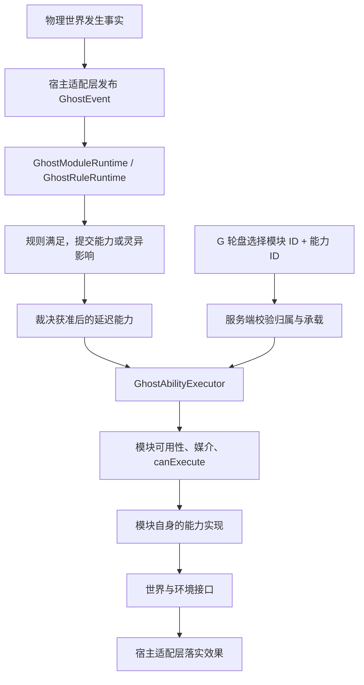

# 厉鬼模块开发指南：从零构建一只完整的厉鬼

适用版本：本文按 2026-11-24 当前仓库实现编写，Minecraft 1.21.1 / NeoForge / Java 21。

本文同时说明**当前实现**与**新模块应遵循的约定**，不把尚未提供的宿主能力当成已经实现的功能。示例完整源文件见 [ContactEchoModule.java](examples/ContactEchoModule.java)，它属于文档示例，不会自动注册到游戏。

## 阅读路线

1. [模块到底是什么](#1-模块到底是什么)
2. [当前能力定义与执行链](#2-当前能力定义与执行链)
3. [先设计规则、媒介、能力](#3-先设计规则媒介能力)
4. [完整示例：触响鬼](#4-完整示例触响鬼)
5. [注册、语言与图标](#5-注册语言与图标)
6. [让不同宿主携带模块](#6-让不同宿主携带模块)
7. [实例状态与存档](#7-实例状态与存档)
8. [语义事件与调用参数](#8-语义事件与调用参数)
9. [扩展接口与特殊能力](#9-扩展接口与特殊能力)
10. [灵异裁决与复苏代价](#10-灵异裁决与复苏代价)
11. [调试、测试与常见问题](#11-调试测试与常见问题)
12. [现阶段边界与发布清单](#12-现阶段边界与发布清单)

## 1. 模块到底是什么

**一个 `GhostModule` 代表一只完整的厉鬼。** 同一只厉鬼可以有多个规则、多个媒介和多个独立能力。不要给同一只鬼的每个技能分别创建一个模块。

例如鬼签是一个模块，活签、死签、鬼签是三个能力；开门鬼和关门鬼则是两个模块。

| 概念 | 职责 | 示例 |
| --- | --- | --- |
| 模块定义 `GhostModule` | 描述整只厉鬼、初始属性、规则、技能、承载形式 | 鬼寿衣、鬼签 |
| 实例 `GhostModuleData.Entry` | 保存当前强度、复苏、沉睡、死机、专属数据 | 玩家身上的这一只鬼签 |
| 规则 `GhostRule` | 决定何时自动发起能力或影响 | 接触开始、声音中断、受到袭击 |
| 媒介 `GhostMedium` | 无论哪个渠道调用，都必须满足的条件 | 正在接触、暴露在世界、覆盖表面 |
| 能力 `GhostAbility` | 一项具体技能的条件、元数据和世界效果 | 发动袭击、开关鬼域 |
| 语义事件 `GhostEvent` | 描述已经发生、经过采集确认的事实 | `TouchEvent` |
| 调用参数 `GhostAbilityParameters` | 描述一次操作所需的输入 | 指定目标、指定门 |
| 宿主与适配层 | 存数据、采集事实、实现世界操作 | 玩家、实体、物品、方块 |

### 最重要的边界

模块不判断自己由谁承载，也不取得宿主后再向下转型。

模块可以使用：

```java
context.getModuleContext().world();
context.getModuleContext().environment();
context.getModuleContext().targetState();
```

模块中不要使用：

```java
context.host();                         // 不取得宿主对象
// instanceof PlayerGhostModuleHost    // 不判断宿主类型
// new GhostItemModuleHost(...)        // 不创建宿主适配器
// GhostModuleHosts.living(...)        // 不绕路取回宿主实体
```

事件或参数中的目标实体是世界作用对象。允许处理目标，不等于允许查询模块自身的宿主。不要把 `GhostInvocationParameters.recipient()` 当作“获取宿主”的后门。

`Source.RULE / BEHAVIOR / POSSESSION` 表示调用来源，可以用于解释复苏代价；它不是宿主类型，不应被用来推断“这个宿主一定是玩家”。

模块定义在注册表中复用。`static final` 常量、不可变能力列表可以保存在定义里；某个实例的目标、冷却和成长值不能放进定义对象或全局静态字段。

## 2. 当前能力定义与执行链

### 2.1 唯一能力列表

新模块覆盖 `getIntrinsicAbilities()`：

```java
@Override
public List<GhostAbility> getIntrinsicAbilities() {
    return List.of(new FirstAbility(), new SecondAbility());
}
```

当前 `getAbilities()` 默认返回该列表的不可变副本。开发新模块不应另外覆盖它来维护第二份技能目录。

以下旧机制已经移除，不要重新引入：

- `getActiveAbilities()` 与主动技能白名单。
- `manuallySelectable()` 过滤。
- `GhostActiveAction` 预设技能枚举。
- `WorldActionAbility` 与集中式动作分发。
- 每个模块自动附加的 `player_action`。

**默认能力是公开技能；私有能力仍保留定义，但不进入玩家技能目录。** 目录收集玩家已经驾驭、满足承载条件的模块。未配置时按实例保存顺序、能力声明顺序取前十项；H 面板第三页或 Alt＋G 可从完整目录拖动技能到十个固定槽位，因此超过十项的技能也可装备。

寻路更新、冷却递减、鬼域资源维护、持续代价计时等内部工作，不要仅为复用执行器而注册成技能。

### 2.2 一个能力需要定义什么

| 方法 | 当前默认值 / 用法 |
| --- | --- |
| `getId()` | 必须实现；模块内唯一且长期稳定 |
| `translationKey()` | `ability.<namespace>.<path>`，路径中的 `/` 替换为 `.` |
| `iconTexture()` | 默认原版下界之星；建议显式声明完整 PNG 路径 |
| `media(context)` | 默认空；能力自己的硬性媒介 |
| `inheritsModuleMedia()` | 默认 `true`；同时检查模块媒介 |
| `canExecute(context)` | 必须实现；只判断，不改变状态 |
| `execute(context)` | 必须实现；兼容无返回结果调用 |
| `executeWithResult(context)` | 默认调用 `execute()` 后返回 `true`；真实效果可能失败时应覆盖 |
| `getStimulation(context)` | 默认无复苏刺激；代价声明见第十节 |

媒介组合方式：

```text
模块 getMedia(context)（仅在 inheritsModuleMedia 为 true 时）
    + 当前能力 media(context)
    → 所有媒介都通过
    → canExecute
    → 复苏刺激与效果执行
```

共享条件放模块媒介；某一个技能的条件放技能媒介。不要把“必须开着鬼域”写成整个模块的共用条件，导致“打开鬼域”自身无法使用。

`inheritsModuleMedia() == false` 是完全替换模块共用媒介，不是忽略所有条件。使用它时必须说明为什么这个技能不适用模块共用条件，并完整声明自己的前提。

### 2.3 两种实现写法

复杂技能推荐普通类或匿名 `GhostAbility`，便于分别声明媒介、代价和成功结果。

简单技能可以使用 `DefinedGhostAbility`：

```java
new DefinedGhostAbility(
        ResourceLocation.fromNamespaceAndPath("qisplan2", "example/domain_up"),
        ResourceLocation.parse("minecraft:textures/item/glowstone_dust.png"),
        c -> c.getModuleContext().world().domain().exists()
                && c.getModuleContext().world().domain().layer() < 6,
        c -> c.getModuleContext().world().domain().setLayer(
                c.getModuleContext().world().domain().layer() + 1)
)
```

需要导入 `DefinedGhostAbility` 和 `ResourceLocation`。这是用法片段，不是需要新增的全局注册项。

该 record 仅保存模块传入的条件和效果函数，没有预设技能、技能 ID 分发或宿主分支。它仍继承模块媒介；需要自定义刺激或能力专属媒介时，改用普通 `GhostAbility`。

### 2.4 实际执行流程



规则和轮盘最终调用的是同一个能力 ID、同一份实现。轮盘不会自动生成 `TouchEvent`、`DoorChangedEvent` 或“受到袭击”事实。

### 2.5 状态限制的准确含义

`RULE`、`BEHAVIOR` 要求模块满足 `GhostModuleCombatState.available()`；承载失败、沉睡、死机等会使其不可用。

当前 `GhostAbilityContext.isModuleAvailable()` 对 `POSSESSION` 的实现，是检查模块存在且可承载，然后绕过整个 `available()` 检查。因此当前代码不只是绕过裁决死机，也绕过该检查包含的沉睡和裁决死机状态。若未来要单独限制主动调用时的沉睡行为，需要修改统一策略，不能在各技能里悄悄添加宿主分支。

这不意味着主动技能无条件成功：媒介、目标资格、能力条件、世界接口支持范围仍然有效。

## 3. 先设计规则、媒介、能力

先写设计表，再写类。本文的教学模块叫“触响鬼”：

| 项目 | 定义 |
| --- | --- |
| 模块 ID | `qisplan2:contact_echo` |
| 初始属性 | 强度 10，复苏 0 |
| 形式 | 独立式，使用框架默认值 |
| 规则 | 开始接触一个存活目标时，尝试发动袭击 |
| 媒介 | 具有有效接触目标 |
| 能力 | `qisplan2:contact_echo/contact_attack` |
| 主动输入 | 服务端视线目标或可信调用参数；仍要验证当前确实接触 |
| 复苏代价 | 实际击杀成功时增加 1 点复苏 |
| 持久状态 | 本例不需要额外状态 |
| 世界效果 | 调用 `world.attack()` |

“开始接触”是自动触发规则；“正在接触”是硬性媒介。主动调用可以越过前者，不能越过后者。

如果设计的是“累计接触十五秒才自动袭击”，累计时间应放规则及关系状态中。不要让主动袭击也必须先积攒十五秒，除非你确实希望十五秒成为所有渠道共用的能力前提。

## 4. 完整示例：触响鬼

将示例复制到：

```text
src/main/java/com/qidate/qisplan2/ghost/module/implementation/example/ContactEchoModule.java
```

示例只复用已有接口和资源，不新增实体类、不新增按键、不新增技能网络包。它不会通过 `customData` 修改不可变宿主，因此同一能力也能使用静态来源提供的接触事实。

```java
package com.qidate.qisplan2.ghost.module.implementation.example;

import com.qidate.qisplan2.death.ModDamageTypes;
import com.qidate.qisplan2.ghost.module.GhostMedium;
import com.qidate.qisplan2.ghost.module.GhostModule;
import com.qidate.qisplan2.ghost.module.GhostRule;
import com.qidate.qisplan2.ghost.module.GhostRuleContext;
import com.qidate.qisplan2.ghost.module.ability.GhostAbility;
import com.qidate.qisplan2.ghost.module.ability.GhostAbilityInfluence;
import com.qidate.qisplan2.ghost.module.ability.GhostAbilityContext;
import com.qidate.qisplan2.ghost.module.ability.GhostAbilityStimulation;
import com.qidate.qisplan2.ghost.module.ability.GhostTargetParameters;
import com.qidate.qisplan2.ghost.module.data.GhostModuleInitialData;
import com.qidate.qisplan2.ghost.module.event.GhostEvent;
import com.qidate.qisplan2.ghost.module.event.TouchEvent;
import com.qidate.qisplan2.ghost.module.influence.GhostInfluenceCollector;
import com.qidate.qisplan2.ghost.module.influence.GhostInfluenceType;
import java.util.List;
import net.minecraft.resources.ResourceLocation;
import net.minecraft.world.entity.LivingEntity;

/**
 * 教学模块：触响鬼。
 * 规则：开始接触时尝试袭击；媒介：存在有效接触目标；能力：接触袭击。
 * 定义不持有任何宿主对象或单个实例的可变状态。
 */
public final class ContactEchoModule implements GhostModule {
    public static final ResourceLocation ID = id("contact_echo");
    public static final ResourceLocation ATTACK = id("contact_echo/contact_attack");
    private static final ResourceLocation RULE = id("contact_echo/contact_begin");
    private static final ResourceLocation MEDIUM = id("contact_echo/contact");
    private static final ResourceLocation ICON =
            ResourceLocation.parse("minecraft:textures/item/iron_sword.png");
    private static final List<GhostAbility> ABILITIES = List.of(new ContactAttack());
    private static final List<GhostRule> RULES = List.of(new ContactRule());

    /** 所有定义标识使用模块所在命名空间。 */
    private static ResourceLocation id(String path) {
        return ResourceLocation.fromNamespaceAndPath("qisplan2", path);
    }

    /** 返回整只厉鬼的唯一身份。 */
    @Override public ResourceLocation getId() { return ID; }

    /** 只影响新建实例，不覆盖存档中的实时属性。 */
    @Override public GhostModuleInitialData getInitialData() {
        return new GhostModuleInitialData(10, 0);
    }

    /** 教学示例不自动增长复苏；能力成功时单独结算刺激。 */
    @Override public double getNaturalRevivalRate() { return 0; }

    /** 模块图标与技能图标分别声明，即使本例复用同一纹理。 */
    @Override public ResourceLocation iconTexture() { return ICON; }

    /** 规则只是自动调用入口。 */
    @Override public List<GhostRule> getRules() { return RULES; }

    /** 唯一技能列表；自动规则和轮盘均使用这里的同一能力。 */
    @Override public List<GhostAbility> getIntrinsicAbilities() { return ABILITIES; }

    /** 本例只有一个技能，接触条件作为模块共用媒介。 */
    @Override public List<GhostMedium> getMedia() {
        return List.of(new GhostMedium() {
            /** 媒介 ID 与规则、能力 ID 分开命名。 */
            @Override public ResourceLocation getId() { return MEDIUM; }

            /** 仅检查条件，不支付代价、不改变世界。 */
            @Override public boolean allows(GhostAbilityContext context) {
                return contactTarget(context) != null;
            }
        });
    }

    /**
     * 自动调用使用可信接触事实；直接调用使用输入目标或世界视线。
     * 主动调用不能凭空制造接触，必须由世界接口再次验证实际接触关系。
     * 静态来源的 TouchEvent.source 可以为空，因此不把它当作必须存在的实体。
     */
    private static LivingEntity contactTarget(GhostAbilityContext context) {
        if (context.event() instanceof TouchEvent event) {
            LivingEntity target = event.target();
            return target.isAlive() && !target.level().isClientSide() ? target : null;
        }
        var world = context.getModuleContext().world();
        LivingEntity target = context.parameters() instanceof GhostTargetParameters input
                ? input.target() : world.aimedTarget(3);
        return target != null && target.isAlive() && !target.level().isClientSide()
                && world.touching(target) ? target : null;
    }

    /** 开始接触是自动触发条件；持续接触不重复触发本规则。 */
    private static final class ContactRule implements GhostRule {
        /** 返回规则标识。 */
        @Override public ResourceLocation getId() { return RULE; }

        /** 只订阅真正的接触语义事实。 */
        @Override public boolean supports(GhostEvent event) {
            return event instanceof TouchEvent;
        }

        /** 自动规则要求接触刚发生；这一条件不限制主动技能。 */
        @Override public boolean canTrigger(GhostRuleContext context, GhostEvent event) {
            return event instanceof TouchEvent touch && touch.isBeginning()
                    && touch.target().isAlive() && !touch.target().level().isClientSide();
        }

        /** 收集同目标保护诅咒，再提交袭击影响，裁决获准后才执行能力。 */
        @Override public void onTrigger(GhostRuleContext context, GhostEvent event) {
            var target = ((TouchEvent) event).target();
            var server = target.getServer();
            if (server == null) return;
            GhostInfluenceCollector.collectCurses(context, target.getUUID(), server);
            context.submitAbilityInfluence(ATTACK, event, target.getUUID(),
                    GhostInfluenceType.ATTACK, context.getModuleContext().effectiveIntensity());
        }
    }

    /** 真正的技能实现；这里不认识实体宿主、玩家宿主或物品宿主。 */
    private static final class ContactAttack implements GhostAbility {
        /** 主动技能也先参与裁决，不能绕过目标上的持续保护。 */
        @Override public GhostAbilityInfluence activeInfluence(GhostAbilityContext context) {
            return GhostAbilityInfluence.of(contactTarget(context),
                    GhostInfluenceType.ATTACK, context.getModuleContext().intensity());
        }

        /** 返回技能 ID，语言键默认由它推导。 */
        @Override public ResourceLocation getId() { return ATTACK; }

        /** 返回完整纹理资源路径。 */
        @Override public ResourceLocation iconTexture() { return ICON; }

        /** 重检目标，防止延迟执行时继续使用已失效对象。 */
        @Override public boolean canExecute(GhostAbilityContext context) {
            return contactTarget(context) != null;
        }

        /** 每次实际击杀成功增加一点复苏，由执行器统一结算。 */
        @Override public GhostAbilityStimulation getStimulation(GhostAbilityContext context) {
            return new GhostAbilityStimulation(1,
                    GhostAbilityStimulation.Timing.ON_EFFECT_SUCCESS);
        }

        /** 兼容不需要效果返回值的调用者。 */
        @Override public void execute(GhostAbilityContext context) {
            executeWithResult(context);
        }

        /** 通过抽象世界接口发动袭击，并返回真实结果。 */
        @Override public boolean executeWithResult(GhostAbilityContext context) {
            LivingEntity target = contactTarget(context);
            if (target == null) return false;
            var module = context.getModuleContext();
            // 教学示例复用不可触之鬼伤害类型；正式发布时可注册独立伤害类型与死亡译文。
            return module.world().attack(target, ModDamageTypes.UNTOUCHABLE_GHOST,
                    module.effectiveIntensity());
        }
    }
}
```

### 示例的重要取舍

- 自动调用由可信采集层提供 `TouchEvent`，不要求静态来源必须有实体形态。
- 主动调用会重新验证物理接触，视线命中本身不等于接触。
- `GhostTargetParameters` 仅供服务端或内部可信调用者使用；当前轮盘包不接受客户端指定的目标 UUID。
- 定义不保存实例状态，多个宿主共享定义不会共享冷却或目标。
- 本例复用 `UNTOUCHABLE_GHOST` 伤害类型，所以死亡消息也沿用该类型。正式发布可增加自己的伤害类型及数据资源；不要只改字符串而漏掉伤害类型注册。
- `world.attack()` 返回真实袭击结果；本例 `ON_EFFECT_SUCCESS` 表示击杀成功才结算一点复苏，不是“按下技能就收费”。

## 5. 注册、语言与图标

### 5.1 注册模块一次

在 `GhostModuleRegistry.bootstrap()` 增加：

```java
register(new ContactEchoModule());
```

并添加导入：

```java
import com.qidate.qisplan2.ghost.module.implementation.example.ContactEchoModule;
```

重复注册相同模块 ID 会抛异常。注册表保存定义，不能为每个玩家注册一次。

### 5.2 添加中英文语言键

合并到 `src/main/resources/assets/qisplan2/lang/zh_cn.json`：

```json
{
  "module.qisplan2.contact_echo": "触响鬼",
  "ability.qisplan2.contact_echo.contact_attack": "触响袭击"
}
```

合并到 `en_us.json`：

```json
{
  "module.qisplan2.contact_echo": "Contact Echo Ghost",
  "ability.qisplan2.contact_echo.contact_attack": "Contact Echo Strike"
}
```

以上是要加入的键，不要覆盖整个语言文件。模块名称用 `module.*`，技能名称用 `ability.*`，二者是不同层次。

技能 ID `qisplan2:contact_echo/contact_attack` 默认推导出 `ability.qisplan2.contact_echo.contact_attack`。不要把资源 ID 对象直接当作 `Component.translatable` 的格式参数；需要显示 ID 时转换成字符串。

### 5.3 自定义图标

本例使用原版纹理，无需新增资源。自定义图标例如：

```java
ResourceLocation.parse("qisplan2:textures/gui/ability/contact_echo.png");
```

对应文件：

```text
src/main/resources/assets/qisplan2/textures/gui/ability/contact_echo.png
```

这是完整纹理路径，不是物品注册 ID，也不是模型 ID。技能图标应返回非空资源位置；模块卡片的 `GhostModule.iconTexture()` 允许为空，不代表技能图标也可以为空。

### 5.4 自动进入能力目录与轮盘

玩家实际驾驭并成功承载该模块后，`GhostAbilityCatalog` 自动收集 `isPublicSkill() == true` 的能力。无需修改 `ClientKeyHandler`、`GhostAbilityNetwork` 或新增专用技能包。

当前交互：按住 G 打开，鼠标悬停选择，松键或左键提交，中心/外部/Esc 取消。扇区显示图标和技能名称，中央显示选中的完整名称与所属模块。

配置页按厉鬼分组显示全部能力，支持滚轮与滚动条。新技能拖入扇区替换原技能，已装备技能拖入另一槽位交换位置；右键清空槽位，或将轮盘技能拖到中心移除。编辑自动保存，也可恢复默认或手动重试保存。

布局以模块 ID 与能力 ID 保存到客户端游戏目录的 `config/qisplan2-ability-wheel.json`，按玩家 UUID 区分。丢失能力时保留原槽为空，重新获得后恢复，不挪动其他技能；该文件不赋予能力，服务端仍校验归属、承载与媒介。

轮盘十个槽位另有快捷键，默认小键盘 1～9、0，可在按键设置中独立修改；读取玩家保存的槽位布局，空槽或已私有化能力不发送请求。移除或私有化旧技能后保留空槽，不自动移动其他技能。

### 5.5 通用鬼域快捷键

能力可通过 `domainShortcut()` 声明可选的 `GhostDomainShortcut` 输入语义；`DefinedGhostAbility` 的第五个构造参数可直接传入该声明，原四参数构造不绑定快捷键。该枚举仅用于选择能力，不定义技能效果，也不要求模块认识玩家宿主。

默认键：化虹 R，目标升降层 Page Up / Page Down，自身升降层 ↑ / ↓，总层数升降 小键盘＋ / －。均可在按键设置中重绑。输入桥从已驾驭、可承载且鬼域已开启的能力中选择匹配项；多个模块匹配时按模块保存顺序取第一个。只声明自己支持的操作（目前鬼眼七项，鬼雾为化虹及目标升降层三项）。

快捷键与轮盘发送相同的 `GhostAbilityUsePayload`，共用服务端归属检查、媒介和效果执行。界面打开、失焦、死亡或旁观时不触发快捷能力，轮盘中的能力仍保留。

### 5.6 私有能力与持续能力

`GhostAbility.isPublicSkill()` 默认返回 `true`。覆盖为 `false` 后，该能力仍能由规则、行为及可信的持续流程调用，但不会显示在技能目录、轮盘和快捷键中。服务端目录校验与 `GhostAbilityExecutor` 同时拒绝直接 `POSSESSION` 调用私有能力，不能只隐藏 UI。

```java
/** 只能由真实语义事件触发，不可单独作为技能。 */
@Override public boolean isPublicSkill() { return false; }
```

私有不等于没有媒介。敲门袭击必须收到 `DoorKnockHeardEvent`；钢琴袭击必须收到真正的音乐中断事件；喊名袭击必须是已听到喊名的当前目标完成回头。不得为私有能力保留自由瞄准的替代目标。

持续能力把运行状态保存到模块 `customData`。公开开始技能写入状态；模块 `tickAbilities(context)` 推进已启动过程，`onAbilityEvent(context, event)` 接收后续世界事实。通过 `context.continueAbility(...)` 使用内部 `CONTINUATION` 来源，仍经过媒介、条件、刺激与主动影响裁决。生命周期不是自动规则，不应用来无条件开启能力，网络不能指定该来源。规则死机不会终止玩家已经主动启动且仍满足媒介的能力。

当前对应关系：

| 模块 | 公开技能 | 私有能力 |
| --- | --- | --- |
| 敲门鬼 | 敲门 | 听声后的袭击 |
| 鬼钢琴 | 播放／停止灵异音乐 | 中断袭击 |
| 鬼石砖 | 无 | 摧毁反击 |
| 喊人鬼 | 持续喊名／取消跟踪（空放也取消） | 来源进入目标视野后的袭击 |
| 红／白鬼烛 | 点燃／熄灭 | 持续吸引／屏蔽 |
| 鬼地毯、鬼草丛、鬼雾 | 保留接触袭击、侵蚀等主动能力 | 不因“袭击”名称批量私有化 |

钢琴在自主且未死机、未沉睡时默认播放，已驾驭来源默认不播放；显式播放／停止保存在 `musicPlaying`、`manualMusic`。声源通过统一适配器注册，传播中断继续发布原有语义事实。

喊名启动时固定目标初始水平朝向对应的后方偏移；来源只随目标位置平移，不随转头绕到另一侧。每 100 tick 喊名一次，转动预算逐次为 70°、140°、180°（封顶），每 tick 速度从 6° 逐次增加至 12°。实际转向朝来源位置计算，包含俯仰并避免越过。转动前后立即检查：来源进入前方 120° 视锥且无遮挡才触发私有袭击，不再使用累计 165° 阈值。空放喊名或取消跟踪技能会清空目标和牵引状态，取消不要求追踪媒介。无听力标签阻止强制转头，但目标主动看见来源仍可触发袭击。

鬼烛模块只请求燃烧状态和连续消耗，载体适配器决定代价：可损耗物品扣耐久，普通生命来源（含玩家）永久扣最大生命并显示原版着火状态，模块化厉鬼实体只显示火焰而不支付此项代价。基础速率沿用 0.05／tick（1／秒），附近厉鬼和屏蔽声音可加快消耗；最大生命不足支付且至少保留 1 点时自动熄灭。没有耐久的物品与方块仍使用模块存储燃料。停止燃烧立刻移除环境效果。

## 6. 让不同宿主携带模块

注册定义并不等于世界里已经出现了这只鬼。还需要安装实例或配置默认实例。

### 6.1 玩家与调试命令

在具有相应权限的开发环境中：

```text
/qisplan2 module list
/qisplan2 possess qisplan2:contact_echo
/qisplan2 module player info
/qisplan2 release qisplan2:contact_echo
```

`/qisplan2 module player` 当前提供查询入口，不要写成不存在的 `module player add` 命令。正常玩法的驾驭由统一驾驭流程完成，不为新模块另建 possession ability。

### 6.2 通用实体宿主

普通厉鬼使用 `ModularGhostEntity` 携带模块。只有确实需要独特物理模型或宿主组成时，才创建继承该通用类的实体。

自定义实体构造器可调用：

```java
super(type, level, composition,
        List.of(new GhostModuleData.Entry(ContactEchoModule.ID, 10, 0)));
```

这是构造器内的片段，`type / level / composition` 由具体实体提供。无需为每种规则重建一个专用实体行为类；缺少的物理行为应在适配层实现。

新增实体类型仍需正常注册属性、渲染器等宿主资源。注册模块本身不会完成这些 Minecraft 实体注册工作。

### 6.3 普通物品与剑

普通模块物品可继承 `GhostModuleItem`。默认模块通过数据组件设置：

```java
properties.component(
        ModDataComponents.GHOST_MODULES.get(),
        List.of(new GhostModuleData.Entry(ContactEchoModule.ID, 10, 0))
)
```

参考 `GhostDivinationSlipItem` 的实际构造方式。这个表达式用于物品属性配置，不需要把数据再写一份到模块定义中。

Java 不支持同时继承 `SwordItem` 和 `GhostModuleItem`。需要保留剑父类时实现 `GhostModuleItemSupport`，再正确转交 `useModules`、`tickModules` 等生命周期入口。

给现有物品安装模块可用：

```text
/qisplan2 module item add qisplan2:contact_echo
/qisplan2 module item info
/qisplan2 module item remove qisplan2:contact_echo
```

给物品添加实例与采集物理事实是两件事。普通右键物品入口发出的是 `GhostUseEvent`，不会自动变成接触规则；示例需要现有接触采集入口或为该物品补齐对应事实采集。

### 6.4 静态方块宿主

`StaticBlockModuleHost` 适合模块配置固定、无需逐方块保存实例状态的方块：

```java
new StaticBlockModuleHost(ContactEchoModule.ID, 10);
```

宿主适配或方块接触采集代码在服务端确认接触后分发：

```java
GhostModuleRuntime.dispatch(host, TouchEvent.sample(null, target, beginning));
```

`host / target / beginning` 由采集层取得。`beginning` 必须来自真实的进入/离开检测，不能每 tick 一律传 `true`，否则“开始接触”规则会每 tick 重复触发。

静态宿主没有实体形体，也不一定保存自身世界坐标。能力不能为了工作而强制向它索取实体来源。本例使用可信接触事件里的目标，并把实际袭击交给世界接口。

### 6.5 承载形式与侵蚀

默认独立式不占承载部位。替换式例如：

```java
@Override
public GhostModuleForm form() {
    return GhostModuleForm.replacing(SpiritualPart.SKIN);
}
```

侵蚀独立声明：

```java
@Override
public GhostCorrosion corrosion() {
    return GhostCorrosion.builder()
            .add(SpiritualPart.SKIN, 60)
            .build();
}
```

占皮肤与侵蚀皮肤不是同一个概念。当前玩家和基础实体默认 21 个部位，`GLOBAL` 不计入承载部位；物品和方块默认万能部位。部位冲突会导致安装失败或已有旧实例失去运行资格。

详细规则见 [宿主灵异承载](ghost-bearing.md)。不要在模块里写“玩家占皮肤、物品占万能部位”的分支，匹配由承载框架负责。

## 7. 实例状态与存档

### 7.1 通用属性和专属属性分开

实例条目保存：

```text
id / intensity / revival / sleeping / deadlocked / customData
```

强度、复苏、沉睡和裁决死机不应在 `customData` 中重复保存。压制积累、沉睡剩余深度与短时袭击等框架状态存放在保留结构 `qisplan2:combat`，不要覆盖它。

`getInitialData()` 只提供新建实例初始值。修改定义初始强度不会自动重置已有存档。

### 7.2 正确读写 customData

对支持模块专属数据读写的宿主，使用上下文读副本、修改、写回：

```java
var module = context.getModuleContext();
var data = module.getCustomData();
int count = Math.max(0, data.getInt("successfulUses"));
data.putInt("successfulUses", count == Integer.MAX_VALUE ? count : count + 1);
module.setCustomData(data);
```

不要只 `putInt` 而不写回，也不要新建空 NBT 后覆盖整个 `customData`，否则会丢失其他框架状态。

保存目标 UUID 而不是长期持有实体对象；重新加载或执行前通过世界接口重新解析和校验。字段改版时用自己的版本字段和明确迁移规则，保留不认识的字段。

### 7.3 不可变宿主的真实限制

当前 `GhostModuleContext.getCustomData()` 和 `setCustomData()` 要求宿主实现 `GhostModuleCustomDataModifier`，不具备接口会抛异常。`setIntensity / setRevival` 同理要求 `GhostModuleDataModifier`。

`StaticBlockModuleHost` 当前不提供这些写接口，且不允许复苏刺激。不要在模块中通过 `instanceof` 判断静态宿主来规避问题，应选择合适的数据能力或扩展接口。

- 每个宿主必须独立保存的状态：为相应宿主提供持久化容器/接口。
- 与目标关联的累计接触、袭击时间：考虑 `module.targetState().read(target)` / `write(target, state)`，参考鬼地毯和鬼草丛。
- 是否每块方块独立计时、是否同类静态来源共享关系状态，取决于适配器的存储范围，必须在设计中明确。

本教程的完整模块不读写 `customData`，因此没有这项额外持久能力要求。

### 7.4 强度与复苏单位

- `intensity()`：实例保存的本质强度。
- `effectiveIntensity()`：通过适配层计算的当前可发挥强度；当前服务端玩家会走驭鬼强度计算。
- `revival()`：模块保存的原始数值，默认上限 100；不要与旧驭鬼视图中常见的 0～1 比例混用。
- `getNaturalRevivalRate()`：定义声明的每秒自然复苏值，但具体宿主仍要有对应推进逻辑。

规则提交影响时与技能真正袭击时应采用一致的强度口径。本例两处都用 `effectiveIntensity()`。

## 8. 语义事件与调用参数

### 8.1 事件必须是事实

先复用 `ghost.module.event` 中已有事件，再考虑新增：

- 接触：`TouchEvent`。
- 看见/被感知：`EntityPerceivedEvent`。
- 门变动：`DoorChangedEvent`。
- 听见敲门：`DoorKnockHeardEvent`。
- 灵异声音变化：`GhostSoundEvent`。
- 受到灵异袭击：`SupernaturalAttackEvent`。
- 生命周期采样：`ModuleTickEvent`。

新增事件放到 `com.qidate.qisplan2.ghost.module.event` 独立类中，不嵌在具体模块内。

“目标刚转身”可以是事件；“请求释放转身杀技能”不是语义事件。“请求敲指定门”用调用参数，敲门后真的听到了声音才产生听声事件。

### 8.2 主动输入

当前轮盘发送 `GhostAbilityUsePayload(moduleId, abilityId)`。服务端重新校验玩家、归属、承载和目录，再构造 `POSSESSION` 上下文，事件为 `null`，参数为服务端提供的 `GhostInvocationParameters(player)`。

因此新能力要明确处理：

1. 自动规则的事实目标在哪里？
2. 主动调用怎样取得目标？
3. 输入对象为空、离开范围、跨世界或已死亡时如何失败？
4. 延迟执行时是否仍能通过媒介？

常用主动目标出口为 `world.aimedTarget(range)`、`world.aimedBlock(range)`；当前实现对范围有上限，不能假定任意大数有效。

更复杂的能力可以新增实现 `GhostAbilityParameters` 的参数 record，由可信输入适配器构造。不要把整份宿主对象塞进参数。当前轮盘没有通用多阶段选目标、文本输入或任意参数序列化界面；需要这类操作时必须扩展通用输入流程，不能假装声明了能力就已经支持。

### 8.3 外部调用能力的正确方式

以下片段属于宿主/输入适配层，**不放进模块定义**：

```java
var invocation = new GhostAbilityContext(
        host,
        ContactEchoModule.ID,
        ContactEchoModule.ATTACK,
        GhostAbilityContext.Source.POSSESSION,
        null,
        () -> {},
        new GhostTargetParameters(target)
);
boolean success = GhostAbilityExecutor.tryExecuteWithResult(invocation);
```

调用者必须先确认 `host` 携带已注册的模块；构造器会校验模块和能力 ID，不能把异常当作普通校验返回值。

不要直接 `ability.execute(context)`，否则会绕过统一媒介、状态和刺激结算。

## 9. 扩展接口与特殊能力

### 9.1 当前可用的能力接口

| 接口/入口 | 适合表达 |
| --- | --- |
| `world()` / `GhostWorldAccess` | 移动、袭击、接触、指向目标、门操作、蔓延 |
| `environment()` / `GhostEnvironment` | 暴露、覆盖表面、燃烧压力、效果发布 |
| `world().domain()` / `GhostDomainAccess` | 当前模块鬼域的层数、覆盖、强度及操作 |
| `targetState()` / `GhostTargetState` | 与目标关联的状态 |
| `BlockSpreadSpec` | 方块种类、数量、二维/三维、蔓延方式、替换规则 |

“接口式编程”不是把一张技能枚举表换成一张字符串技能表。模块应当组合小而明确的世界操作，例如读取鬼域层数，再请求设为下一层；中间层不决定这项技能叫什么、收费多少、是否要求六层鬼域。

### 9.2 缺少世界能力时怎样扩展

1. 先把需求写成宿主无关的操作契约：输入、输出、失败含义、副作用。
2. 检查现有接口能否组合实现。
3. 确实缺少时，为相应环境接口增加操作或一个独立能力接口。
4. 在 `ghost.module.host` 适配层实现实体、玩家、物品、方块能够支持的行为。
5. 不支持的宿主返回明确的不可用结果；模块通过能力前提检查，而不是猜宿主类型。
6. 模块在自身 `getIntrinsicAbilities()` 中声明技能并编排这些操作。
7. 用两个不同的假宿主提供同样接口，验证模块效果一致。

当前接口不是所有宿主都已实现。比如 `GhostDomainAccess` 某些操作默认返回失败，题字需要适配器提供题字出口；模块不认识宿主不代表宿主天然具备所有物理能力。

### 9.3 行为、声音、鬼域与蔓延

- **自主行为**：`behavior()` 当前仍返回 `GhostBehavior`，已有 `NONE / NIGHT_HUNT / KNOCK_DOORS / FOLLOW_CALL / WANDER`。这是现有 Goal 适配入口，不能误称能力预设枚举已经删除，所以所有其他系统也都自动开放。全新行为需要补齐对应适配与调度。
- **语义规则**：自主移动如何发现目标由行为/采集层处理；发现后的语义事实交给规则。行为内部资源维护不要都列成技能。
- **声音**：`getSounds()` 声明 `GhostSoundDefinition`，真实传播和听声变化由声音系统处理；白烛造成的中断应沿用真实语义链，不手工广播一个假的“已听见”。
- **鬼域**：通过 `domainDefinition()` 声明鬼域身体，`world().domain()` 是当前模块的运行时操作接口。统一适配器负责所有宿主的创建、维护和清理；不再添加独立的鬼域控制器、类型注册或客户端效果注册。旧驭鬼界面的兼容视图由 `PlayerGhostData` 根据声明与实例数据派生；模块接口不再提供 `initialDomainData()` 或依赖驭鬼专用数据对象。
- **蔓延**：使用 `world.spreadBlocks(anchor, spec)`。`BlockSpreadSpec.Shape.HORIZONTAL_2D` 是水平四邻域，`VOLUME_3D` 是三维六邻域；`CHAIN` 和 `FRONTIER` 决定扩展方式。数量是成功新增方块数，空间不足允许少于要求，不能无限搜索。

### 9.4 鬼域：模块声明、世界能力与客户端表现

鬼域是模块身体的一部分。分层、覆盖竞争、隔绝、追踪和生命周期属于框架；伤害、袭击等世界效果属于模块能力；雨柱、后处理、雨声属于客户端表现。三者不能混在一个控制器中。

`domainDefinition()` 返回 `Optional.empty()` 表示没有鬼域；返回 `GhostDomainDefinition` 则由统一宿主适配器维护。模块无需注册另一种鬼域，也不需要自己创建 `GhostDomain`。生命周期由 `GhostModuleRuntime` 与宿主适配器负责，模块无需调用手动维护接口。

运行时定位使用“实际宿主＋模块 ID”。物品按物品栈身份区分，不能用携带者 UUID 代替宿主身份；关闭玩家的鬼域不能关闭其手中物品上的同名鬼域。`domainOpen / domainStrength / domainRadius / domainLayer` 保存在模块 `customData`，运行时 `GhostDomain` 由这些数据重建。旧驭鬼数据类型仅保留兼容视图与旧存档迁移用途。

当前适配范围：暴露在世界中的实体、玩家、物品和方块都可展开鬼域；化虹、指向目标升降层与持续重启的输入实现目前仍面向玩家。其他宿主调用这些出口会返回失败，模块不能为此判断宿主类型；扩展支持时应修改适配器与底层操作。

#### 9.4.1 完整的最小模块

下面是可以放入 `ghost/module/implementation/ExampleMistModule.java` 的完整示例。它使用现成的雾气后处理，只公开一个开关能力，不自动造成伤害：

```java
package com.qidate.qisplan2.ghost.module.implementation;

import com.qidate.qisplan2.ghost.domain.shape.SphereDomainShape;
import com.qidate.qisplan2.ghost.module.GhostModule;
import com.qidate.qisplan2.ghost.module.ability.DefinedGhostAbility;
import com.qidate.qisplan2.ghost.module.ability.GhostAbility;
import com.qidate.qisplan2.ghost.module.data.GhostModuleInitialData;
import com.qidate.qisplan2.ghost.module.domain.GhostDomainDefinition;
import com.qidate.qisplan2.ghost.module.domain.GhostDomainShaderEffect;
import java.util.List;
import java.util.Optional;
import net.minecraft.resources.ResourceLocation;

/** 示例厉鬼：声明鬼域身体与开关能力，不认识自己的宿主。 */
public final class ExampleMistModule implements GhostModule {
    public static final ResourceLocation ID = ResourceLocation.parse("qisplan2:example_mist");
    private static final ResourceLocation TOGGLE = ResourceLocation.parse("qisplan2:example_mist/toggle");

    /** 模块身份与着色器资源身份可以不同。 */
    @Override public ResourceLocation getId() { return ID; }

    /** 新实例的初始强度和复苏。 */
    @Override public GhostModuleInitialData getInitialData() {
        return new GhostModuleInitialData(30, 0);
    }

    /** 使用框架球形几何和接触语义，组合一个标准后处理效果。 */
    @Override public Optional<GhostDomainDefinition> domainDefinition() {
        return Optional.of(new GhostDomainDefinition(
                32, 1, false, SphereDomainShape::new,
                true, false, 0, true, true,
                List.of(new GhostDomainShaderEffect(
                        ResourceLocation.parse("qisplan2:ghost_mist"), "GhostMist"))
        ));
    }

    /** 同一能力可以由轮盘、快捷键或其他可信输入渠道调用。 */
    @Override public List<GhostAbility> getIntrinsicAbilities() {
        return List.of(new DefinedGhostAbility(
                TOGGLE,
                ResourceLocation.parse("minecraft:textures/item/ender_pearl.png"),
                context -> context.getModuleContext().world().canToggleDomain(),
                context -> context.getModuleContext().world().toggleDomain()
        ));
    }
}
```

完成集成还需要以下步骤：

1. 在 `GhostModuleRegistry.bootstrap()` 中添加 `register(new ExampleMistModule())`，并按需要导入类。仅注册模块，不再注册鬼域类型。
2. 在 `zh_cn.json` 和 `en_us.json` 中分别添加 `module.qisplan2.example_mist` 与 `ability.qisplan2.example_mist.toggle` 的译文。
3. 通过现有模块命令或宿主的默认模块组件安装该模块。玩家驾驭后，公开开关能力会进入能力目录；物品如果需要右键开关，应另声明响应 `GhostUseEvent` 的规则，参照 `GhostUmbrellaModule`，不能假设定义公开技能就自动绑定物品右键。
4. 本例直接复用 `ghost_mist.json/.vsh/.fsh`，所以无需新增资源或客户端注册。它只复用视觉，不继承鬼雾伤害能力。运行 `gradlew.bat check --offline`，然后在游戏中验证开关、跨维度、移除模块、隔绝与压制后的清理。

`GhostDomainDefinition` 的参数按顺序为：

| 参数 | 含义与实现责任 |
| --- | --- |
| `radius` | 新实例默认范围；运行时范围保存在模块数据 |
| `initialLayer` | 初始层数；框架统一限制在 1～10 |
| `automatic` | 未显式设置开关时，是否允许自主展开；仍受宿主自主许可和模块状态约束 |
| `shape` | 独立几何实例工厂，例如 `SphereDomainShape::new`，不要共享可变形状 |
| `touch` | 有效覆盖是否构成身体接触 |
| `sight` | 有效覆盖是否构成来源看见目标 |
| `exposureInterval` | 周期曝光间隔，以 tick 计；0 表示不产生周期曝光 |
| `entityVision` | 是否使用框架实体视觉 |
| `teleport` | 是否允许框架化虹 |
| `effects` | 不可变的独立效果声明列表；可以为空，也可组合多个不同效果 |

分层和传送的实现继续使用 `world().domain()`。模块可以声明调层能力，但不要复制框架的覆盖优先级或实体追踪算法。

#### 9.4.2 独有效果怎样扩展

`GhostDomainEffect` 是开放接口，**不是框架枚举，也不是一组雨、雪、雾开关**。效果声明必须是服务端安全的数据，不得引用 `Minecraft`、`ShaderInstance` 等客户端类。

当前鬼伞的声明组合为：

```java
List.of(
        new GhostDomainShaderEffect(ID, "GhostUmbrella"),
        GhostRainEffect.INSTANCE
)
```

两项声明有各自的实现：

| 声明 | 客户端适配器 | 负责内容 |
| --- | --- | --- |
| `GhostDomainShaderEffect` | `StandardDomainShaderAdapter` → `ModuleGhostDomainRenderEffect` | 加载 Shader、筛选所属模块的域、绑定标准纹理与参数、交给总管线绘制 |
| `GhostRainEffect` | `GhostRainClient` → `GhostRainRenderer` | 鬼雨专属雨柱、雨声、事件监听和清理；当前雨柱实现使用圆柱几何 |

新增一个独有效果的完整路径为：

1. 在该效果所属模块的包中创建实现 `GhostDomainEffect` 的 record 或类，声明它自己的参数；无参数效果可像 `GhostRainEffect` 一样用单例 enum。
2. 在客户端包实现 `GhostDomainClientEffect<你的声明类型>`。`install(moduleId, definition)` 负责安装该效果；需要 Shader 时覆盖 `registerShaders(event, definition, loaded)`，需要世界渲染、声音或粒子时在自己的适配器中安装相应事件。多模块共享同一监听器时必须防止重复注册，退出世界时清理表现状态，参照 `GhostRainClient`。
3. 在 `QisPlan2Client` 的客户端效果绑定区添加一次 `GhostDomainClientEffects.register(声明类型.class, 适配器)`，位置在 `installModules()` 之前。这里注册的是一种声明的客户端实现，不是再注册厉鬼或鬼域。其他模块复用此效果不必再次注册适配器。
4. 模块在 `domainDefinition().effects()` 中提出该效果。`GhostDomainClientEffects.installModules()` 自动读取所有模块的效果列表；未绑定客户端实现会明确报错，不会静默忽略。匹配采用声明的精确运行时类型。

新增第十种独有效果时，仍只增加该效果的声明、实现和一次客户端绑定，不修改 `GhostDomainDefinition`、`ModuleGhostDomains` 或总渲染管线。影响服务端世界的效果应继续声明为模块能力，通过语义事实或持续能力入口调用，不能藏进客户端效果。

#### 9.4.3 标准着色器前缀到底由谁实现

前缀现在只属于可选效果 `GhostDomainShaderEffect(shaderId, uniformPrefix)`，不再是 `GhostDomainDefinition` 的字段，也不是所有效果必须遵守的约定。

调用链与代码位置是：

1. **模块提出声明**：例如 `new GhostDomainShaderEffect(ID, "GhostEye")`。
2. **客户端绑定声明类型**：`QisPlan2Client` 将 `GhostDomainShaderEffect.class` 绑定到 `StandardDomainShaderAdapter`。
3. **加载资源**：`QisPlan2` 的 Shader 注册事件调用 `GhostDomainClientEffects.registerShaders(event)`，后者委托 `StandardDomainShaderAdapter.registerShaders` 加载声明中的资源 ID。共享的 Shader ID 每次资源重载只加载一次。
4. **安装表现**：`StandardDomainShaderAdapter.install` 创建 `ModuleGhostDomainRenderEffect(moduleId, shaderId, prefix)`；模块 ID 用于筛选鬼域，Shader ID 用于查资源，两者不能混用。
5. **设置参数并绘制**：`GhostDomainRenderPipeline` 准备公共输入，随后调用效果的 `setupSamplers` 和 `setupUniforms`；真正拼接前缀、写参数的是 `ModuleGhostDomainRenderEffect`。管线不识别鬼眼、鬼雾或鬼雨。

以上实现位于 `ghost/domain/client/renderer/`；公共声明位于 `ghost/module/domain/`。标准适配器遵守以下资源契约，其中 `P` 为声明的前缀：

| 输入名称 | 数据来源 | 负责实现 |
| --- | --- | --- |
| `DiffuseSampler` | 场景颜色 | 总渲染管线 |
| `MainDepthSampler` | 复制的主场景深度 | 总渲染管线 |
| `P + RegionIdentity` | 灵异隔绝空间身份纹理 | `ModuleGhostDomainRenderEffect.setupSamplers` |
| `P + ProjMat` / `P + ModelViewMat` | 当前投影矩阵 / 已捕获的世界模型视图矩阵 | `setupUniforms` |
| `P + CameraPos` | 相机世界位置 | `setupUniforms` |
| `P + DomainCenter` / `DomainRadius` | 鬼域中心 / 客户端平滑后的范围 | `setupUniforms` |
| `P + DomainActive` / `DomainLayer` / `DomainStrength` | 启用值 1 / 层数 / 鬼域强度 | `setupUniforms` |
| `P + Time` | 世界时间秒数，按一天循环 | `setupUniforms` |
| `P + SourceRegion` | 来源空间身份；开放空间为 0，否则编码为 `(regionIndex + 1) / 256` | `setupUniforms` |

标准适配器要求 Shader 声明 `P + RegionIdentity` sampler；其他未使用的 uniform 可省略。矩阵、向量与标量的类型和数量必须与代码一致，参照 `ghost_mist.json`。不要通过其他 uniform 是否存在来猜测 sampler。新的专属 sampler 或参数布局应由自己的 `GhostDomainClientEffect` 和 `GhostDomainRenderEffect` 实现，在各自的 `setupSamplers/setupUniforms` 中绑定，不向总管线加入模块名称分支。

#### 9.4.4 从现有 Shader 构建自己的资源

要让上面的示例使用自己的雾气资源，可按以下步骤完成，不需要修改通用 Java 渲染代码：

1. 将 `src/main/resources/assets/qisplan2/shaders/core/ghost_mist.json`、`ghost_mist.vsh`、`ghost_mist.fsh` 复制为同目录下的 `example_mist.json`、`example_mist.vsh`、`example_mist.fsh`。
2. 将 JSON 中 `vertex` 与 `fragment` 的资源 ID 改为 `qisplan2:example_mist`。
3. 在这三个新文件内将 `GhostMist` 参数前缀统一替换为 `ExampleMist`。不要改公共输入 `DiffuseSampler`、`MainDepthSampler` 或顶点属性 `Position`。JSON 的 sampler/uniform 名称必须和 GLSL 完全一致。
4. 将模块声明改为 `new GhostDomainShaderEffect(ID, "ExampleMist")`，然后修改新 `.fsh` 中颜色、噪声等视觉计算。保留已有深度、鬼域边界和空间身份判定，可避免效果穿透隔绝边界或影响全屏。
5. 在资源重载或重新启动客户端后验证。模块、Shader 与语言资源都已接通，不需要额外调用旧的逐鬼域 `register()`。

这种方式复用的是标准输入绑定。若自己的效果完全不使用此参数约定，声明自定义 `GhostDomainEffect` 并实现独立适配器即可，不能为了省事给标准前缀适配器不断增加专属判断。

#### 9.4.5 状态、语义和伤害

开关、强度、范围、层数使用模块 `customData` 中的 `domainOpen / domainStrength / domainRadius / domainLayer`，沿用旧字段。无显式开关时，框架结合 `automatic` 和宿主自主运行许可决定是否展开。玩家默认主动开启；实体、物品和方块共用适配入口。物品按实际物品栈身份区分，不能借用携带者的同名模块。模块移除、载体失效、收起物品或外部完全压制会收回运行时域，持久字段保留；主动开启的能力不因规则死机而失效。

只对追踪器确认的最终有效覆盖集合采集事实，已经被其他鬼域或隔绝规则排除的目标不会收到事件：

- `TouchEvent`：本体与鬼域共用接触采样，一个宿主对一个目标每 tick 最多累计一次。离开后再次进入重新产生 `BEGIN`，不补算离开的时间。
- `TargetSeenEvent(target)`：来源看见目标，与 `SourceSeenEvent(observer)` 方向相反。有实体观察者时，中间层还向目标宿主派发 `EntityPerceivedEvent(observer, target)`。
- `GhostDomainExposureEvent`：周期曝光事实，携带域 ID、来源、目标和域强度。静态来源的实体字段可为空，使用 `world.containsInDomain(event.domainId(), event.target())` 校验归属，不要仅凭事件类型实施效果。

鬼雾声明每 20 tick 采样，并由自己的能力调用 `world.hurt(target, ModDamageTypes.GHOST_MIST, 0.1F)`。`hurt` 是原版数值伤害，不提交灵异袭击影响；`world.attack` 才进入灵异袭击裁决。普通伤害仍受原版伤害和死亡事件处理。当前公开的鬼雾侵蚀技能复用相同的普通伤害能力。

#### 9.4.6 鬼域控制面板与自动化声明

H 总面板的“鬼域”页分为控制与配置两个子页，右侧列出当前玩家实际承载的鬼域模块。模块通过 `domainPanel()` 返回 `GhostDomainPanel`，默认是空声明，界面不会识别具体模块名称。

- `controls`：归一化布局坐标、控件样式（通用按钮或眼形）、语言键、能力 ID、可选整数参数及状态读取函数。点击后由服务端从声明中恢复能力和参数，不接受客户端任意执行代码。
- `common`：通用操作与模块能力 ID 的显式映射，支持 `toggle / domain_up / domain_down / self_up / self_down`。复用已有技能时直接映射；需要预设时选用 `GhostDomainPresets.common(...)`，并将 `commonAbilities(...)` 加入本模块能力集合。
- `buttons`：本模块挑选的额外公开能力，最多显示五项；空项不占位。
- `automations`：自动化下拉目录，包含功能能力 ID 与语言键。自动化能力仍必须出现在模块能力集合中，可以是私有能力。现有分层预设为 `layers(ID, 10)` 与 `layerAbilities(ID, 10)`，二者应配套选入。

控件状态函数只能读模块数据与环境接口，不得读取玩家、实体或方块宿主。声明属于服务端安全代码，不能引用 Minecraft 客户端 GUI 类。专属图形由通用控件样式实现，新的样式可在客户端渲染适配层扩展。

鬼眼的十只眼睛声明在 `GhostEyeDomainControls`：每次点击切换对应位，实际层数等于睁眼数量，全部闭眼则关闭鬼域。普通层数技能改变层数后，眼睛数量会根据真实配置重建；鬼眼层数范围现在是 1～10。开关与层数操作均经过真实能力执行器，因此死机后的主动操作仍可用，完全压制时不能靠面板绕过能力限制。

`GhostDomainAccess.setOpen(...) / setLayer(...) / setTargetLayer(...)` 是通用操作出口。关闭状态的 `setLayer` 只保存下次展开层数；`setTargetLayer` 要求目标仍被当前模块鬼域有效覆盖，且指定层数存在。

#### 9.4.7 进出权限、配置持久化与运行机制

配置只写入模块 `customData` 下的 `qisplan2:domain_settings`，不会覆盖其他能力数据。进出各自保存四类开关、白名单和黑名单，默认关闭。判定顺序为黑名单拒绝、白名单允许、分类开关兜底。名单使用半角逗号分隔，接受玩家档案名或实体注册 ID，并按完整项匹配。分类为凡人、厉鬼、驭鬼者和普通实体；携带一个有模块的物品不等于自己驾驭了模块。

来源自身及旁观者豁免。出生、读档放置不算跨界，开启鬼域时已位于其中的实体也不会被逐出；限制作用于之后的移动。边界采用实体位置点，与原有覆盖判定一致；普通移动、击退、同维度位置提交及原版跨维度传送入口在服务器校验。不会改写既有的物品掉落、经验球、装饰实体追踪排除策略。

移动只查询路径附近区块索引中的候选鬼域；球形与圆柱形使用解析线段求交，避免快速移动两端在域外却穿过鬼域。新增自定义形状应覆盖 `GhostDomainShape.intersectsSegment`，默认采样仅作为兼容实现。域内普通移动不重新构建覆盖关系，跨界后才更新，同区块进出也会及时刷新。

自动化配置包括能力 ID、目标选择表达式和启用状态，最多 64 条，单个选择表达式最多 512 字符。目标可以填玩家名、实体 ID，或 `#mortal / #ghost / #possessor / #ordinary`；页面下拉框会插入稳定标识，也接受四种中文分类名。

运行时每 20 tick 对有效覆盖中的存活生物匹配一次规则，来源自身跳过。按显示顺序使用第一条匹配且启用的规则，防止多个分层动作争抢同一目标。分层动作不会夹到当前最大层：要求的层数尚未开启时不执行，开启后下一周期即可生效。动作走统一能力执行器与媒介检查，使用服务器提供的 `GhostTargetParameters`，不会通过客户端选择任意世界实体。相同目标层数不重复写状态。

面板配置是修改策略，技能按钮是调用能力，两者使用独立的服务端验证分支。网络请求不能上传整个模块 NBT，不能指定任意私有能力，也不能配置模块没有声明的自动化功能。黑白名单与分类勾选点击“保存本侧进出配置”后生效；自动化添加、启停和删除即时保存。

### 9.5 仅有独特外观的实体宿主

`ModularGhostEntity` 可直接继承，其受保护构造器接受 `HostComposition` 和默认模块列表。使用 GeckoLib 外观时，继承 `AnimatedModularGhostEntity`，子类只在构造器中声明这两项数据；参照 `CallingGhostEntity`。不要在子类复制喊名、袭击或追踪逻辑，也不要根据实体类型决定模块能否使用能力。移除默认模块后实体仍保留模型，空模块列表读档时不会重新补回。

实体类型在 `ModEntities` 注册并使用通用属性；刷怪蛋注册真实实体类型，不添加指向 `modular_ghost` 的 `ENTITY_DATA`。独特外观刷怪蛋排在实体厉鬼创造栏最前，原通用宿主和模块预设蛋继续保留。

客户端统一注册 `AnimatedModularGhostRenderer`。`AnimatedModularGhostModel` 按实体类型 ID 查找以下资源，例如 `qisplan2:calling_ghost`：

- `geo/calling_ghost.geo.json`
- `textures/entity/calling_ghost.png`
- `animations/entity/calling_ghost.animation.json`

具体外观实体自行覆盖 `registerControllers`，注册自己的待机、行走与动作控制器，并通过 `getVisualActions()` 声明支持的动作映射；同一映射用于注册 `action` 控制器的可触发动画。公共基类只提供缓存和 `playVisualAction` 同步入口，不规定动画集合或资源名。世界适配器报告动作时，当前外观未声明的动作直接忽略。例如喊人鬼外观搭载敲门模块时仍正常行走和敲门，但不会播放敲门动画，也不需要补充占位资源。现有资源使用 `animation.ghost.*` 名称，例如敲门使用 `animation.ghost.knock`。动画不会反过来驱动规则或判定能力成功。附着物由 `GhostGeoAttachmentLayer` 读取现有快照，在实体局部躯干锚点渲染。

### 9.6 宿主朝向接口

模块通过 `world().facePosition(Vec3)` 面向世界坐标，或通过 `world().faceDirection(Vec3)` 面向世界方向向量，不自行判断宿主类型。零向量、非有限数值或缺少有效世界时返回 false。

适配层解释具体操作：实体设置身体、头部和俯仰朝向，玩家同时同步视角；物品忽略操作，不转动携带者；方块有 `FACING` 时支持六方向，有 `HORIZONTAL_FACING` 时只使用水平分量，否则不操作。该接口只转向，不移动位置。喊名与敲门的世界操作已经在适配层调用它，其他能力可按需要直接调用。

## 10. 灵异裁决与复苏代价

### 10.1 规则触发袭击

规则中优先使用 `submitAbilityInfluence()` 提交袭击/保护竞争。它先准备能力，准备失败不提交；裁决通过后延迟调用执行器，执行时再次检查媒介。

规则的 `submitInfluence()` 袭击入口会统一收集目标身上的有效保护诅咒；显式 `GhostInfluenceCollector.collectCurses(...)` 仍可使用，同一会话按诅咒实例去重。不要把“规则触发”直接等同于“已经成功击杀”。

`GhostModuleRuntime.dispatch(List<...>, event)` 可以把多个宿主放进同一影响批次。需要竞争同一个事实时，应由外部调度统一组织批次，而非让模块自己查找全部宿主。

### 10.2 主动能力的裁决声明

能力通过 `GhostAbility.activeInfluence(context)` 返回本次影响，声明目标、影响类型与实际强度。`GhostAbilityExecutor` 在主动渠道完成状态、媒介、执行条件检查后，收集持续保护并进行裁决；获准后重新校验并执行效果，复苏刺激只结算一次。被压制或死机的本次效果不执行。

```java
@Override
public GhostAbilityInfluence activeInfluence(GhostAbilityContext context) {
    return GhostAbilityInfluence.of(contactTarget(context),
            GhostInfluenceType.ATTACK, context.getModuleContext().intensity());
}
```

声明使用作用对象与抽象环境接口，不读取宿主类型。轮盘、热键和直接 `POSSESSION` 调用共用此入口。旧的模块级 `activeInfluence()` 已移除；不同技能可以分别声明保护、袭击或无裁决。

规则依旧共享其事件会话，不在执行器内重复提交。主动敲门的延迟袭击在实际执行时裁决。移动、开关鬼域、化虹、题字等不直接构成攻防竞争的操作返回 `null`；寿衣仍通过真实待处理袭击事件抵挡。不能把所有能力都强制当成袭击。

鬼签的生签声明保护、死签声明袭击、鬼签结果不声明竞争。生签与同源同强度死签相遇时写入模块死机并清理该生签，本次死签不执行；死机之后，玩家依然可绕过自动规则主动使用满足媒介的能力。

当前持续生签历史数据没有保存具体来源模块实例 UUID，来源区分兼容地依据提供者模块 ID；已经避免把鬼签保护与其他模块的袭击误认为同源。区分同类型但不同实例的来源仍需扩展诅咒存储，不能把模块类型标识当成完整的实例溯源。

### 10.3 三种刺激时机

| 时机 | 含义 | 适合情况 |
| --- | --- | --- |
| `ON_ACCEPTED` | 条件通过、执行效果前结算 | 开始释放就支付代价 |
| `ON_EFFECT_SUCCESS` | `executeWithResult()` 返回成功后结算 | 真实效果成功才付费 |
| `MANUAL_CHECKPOINT` | 效果执行到 `checkpointStimulation()` 时结算 | 明确阶段支付，一次调用只结算一次 |

刺激金额必须是有限非负数。执行器还检查宿主能否修改复苏、模块 `getRevivalPolicy()` 是否允许。不要把“声明了刺激”当作所有宿主都一定已支付。

效果成功与输入被接受不同：`tryExecute()` 表示执行被调用，`tryExecuteWithResult()` 才用于取得真实效果结果。技能需要成功才消耗标记、增加成长或蔓延时，应使用真实结果。

`prepareDeferred()` 可能返回 `null`。延迟 Runnable 执行时重新检查，不代表它自动提供一次性执行保证；调度层仍需避免重复排队。

## 11. 声明模块参与灵异对抗的方式

对抗不是在 `tryKill` 中追加某个厉鬼的专用判断。模块通过 `getAttackResponses()` 声明响应，适配层只收集受袭目标当前承载的模块、装备和有效持续诅咒；没有声明的模块不执行对抗逻辑。

```java
/** 收到袭击时调用既有的私有保护能力。 */
@Override
public List<GhostAttackResponse> getAttackResponses() {
    return List.of((module, attack) -> module.reactAbility(PROTECT, attack.event()));
}
```

这里的 `module` 是 `GhostModuleContext`，只能使用状态和环境端口，不能获取或识别宿主。`reactAbility` 走规则来源的统一执行器，继续检查死机、沉睡、媒介与能力条件。持续主动能力如白烛则根据已启动状态与暴露媒介声明响应，不能无条件绕过状态判断。

`GhostAttackResponse.order()` 决定先后顺序，默认 100。当前约定屏蔽使用 0，支付代价的吸收使用 100，累计型持续保护使用 200；相同顺序保留收集次序。不要依赖具体厉鬼 ID 排序。

响应使用 `attack.event().remainingIntensity()` 获取当前剩余强度。支付代价成功后调用 `absorb(amount)`，完全抵挡可调用 `block()`。支付失败不改变袭击。前层完全阻断后，后层不执行、不会重复扣费。未声明累计型保护时不统计其历史；`attack.recentIntensity()` 在一次袭击中最多记录一次。

脱离原宿主持续存在的影响，可以由 `GhostInfluenceProvider.attackResponse(remove)` 提供响应。诅咒只桥接存续状态、强度和注销出口，具体保护政策仍可放在所属模块中。返回响应后，自动收集器不会再将其作为静态强度保护重复提交。生签保留“最近一秒累计低于保护强度时抵挡，达到上限击穿”的政策；同源强度相当时优先死机并注销该保护。

### 使用真正的裁决强度

`GhostInfluenceOutcome` 包含状态、原始强度、最终有效强度与抵挡量。新回调可用 `session.submitResolved(...)` 接收结果；主动调用可用 `GhostAbilityInfluence.executeResolved(...)` 接收最终强度。能力内部也可调用：

```java
double actual = context.resolvedIntensity(target.getUUID(), originalIntensity);
```

不要把模块 `intensity()` 改成临时剩余值：它仍代表模块本身强度。最终伤害入口会领取同一同步效果的裁决结果，避免寿衣重复付费、生签重复累计；同一回调的第二次实际伤害需要重新结算。嵌套裁决独立保存并恢复上下文，异常退出也会清理。

同步作用域不能跨 tick 或线程保留。延迟能力应在真正生效时重新提交影响，不能保存“已获准”状态后跳过目标的新防护。当前同源政策仍按同类灵异判定，尚未引入跨宿主保存的模块实例身份；不要把会话来源 UUID 当作永久实例 ID。


## 独立附着来源与持续压制

插在目标身体上，不等于被目标驾驭。`AttachedGhostHost` 保存原物品模块，目标只是附着锚点。`GhostAttachmentRecord` 保存独立来源 UUID、完整物品组件及回收标记；它不占用目标承载部位，也不加入玩家能力目录。插入、拔出、加载及同步时更新关系，稳定后只读缓存，不用 tick 刷新死机。

模块通过 `getSuppressions(GhostModuleContext)` 声明持续压制。媒介通过 `world().attachments().embedded()` 查询；普通压制使用有限强度，无解压制使用 `GhostSuppression.absolute()`。模块不知道承载它的是什么，也不处理具体存档、实体或网络。

棺材钉的公开 `coffin_nail/embed` 能力通过 `GhostAttachmentAccess` 查询并实施插入；同一个模块可以放在支持该端口的宿主中。当前实装物理端口支持手持物品来源，未实现物理插入的宿主返回媒介不成立，不在模块内猜测宿主。手持来源的实体交互事实为 `EntityUsedEvent`，通过 `supportsEntityUse()` 声明接收；它不是插入请求本身。

已建立的插入关系由物理媒介维持，源模块死机不自动拔钉。来源存放于附着容器内，不执行普通背包 tick，也不能被目标当作自身模块调用。首版实体交互限制一个插入槽位；存储采用列表，保留多附着扩展空间。拔出、死亡掉落及原宿主最后一个模块被驾驭时返还原物品，不生成默认的新物品；创造模式插入不消费，也不产生可回收副本。

`GhostModuleHost.suppression(moduleId)` 提供已建立关系的状态。行动、规则、能力分别检查权限：基础禁止自主行动，高度同时禁止规则，完全同时禁止能力。主动调用绕过旧死机不代表可以绕过压制。`controlsIntrinsicModules()` 仅由真实驭鬼适配器声明，允许主动调用豁免体内压制，但外来完全压制仍然有效。

附着模型由模块的 `attachmentModel()` 声明，客户端统一注册和渲染；人形使用胸部骨骼，其他原版生物模型提供保守锚点。模型只负责表现，不参与压制计算。棺材钉立体模型直接复用现有锈蚀贴图，背包物品模型保持原样。

本次实现附着来源的稳定身份与压制权限基础，不代表已经完成所有模块的永久实例身份、钢琴压制关系或循环对抗求解器。扩展这些功能应继续沿关系接口实现，不能回到实体上的专用布尔量。


## 压制入睡与沉睡规则观察

灵异防御数值和临时死机倒计时已移除。最终灵异袭击的残余强度直接建立普通压制，持续 20 tick；再次命中替换本次强度并刷新到期时间，不叠加时长。到期仅解除这一短时来源，音乐与附着物等关系仍独立有效。

普通完全压制改为 `P ≥ 1.5 × S`（且 P > 0），基础与高度仍保持严格大于。令 `q = (P / (1.5 × S))²`，连续完全压制达到 `6000 / q` tick 后进入沉睡；恰好1.5倍对应五分钟。完全压制中断便清零入睡进度。无解压制单独取 q=20，即十五秒入睡，不向 NBT 保存无穷大。

初次沉睡获得六十秒自然苏醒深度。沉睡时每个有效宿主 tick 自然减少 1 tick 深度；完全压制每 tick 增加 `2q`，与自然苏醒合并后净增 `2q-1`。普通上限为 `12000q` tick（基础十分钟，三倍强度时四十分钟），无解上限二十四小时。更弱来源接管不会瞬间抹掉已有深度；超过新上限时自然恢复。稳定上限不重复写入状态。卸载/离线不补算时间，数据随模块保存和转移；恢复宿主生命周期后继续。

`entry.sleeping()` 是唯一沉睡开关，`qisplan2:combat.sleepTicks` 只是对应的自然苏醒剩余深度；不要另建一份沉睡布尔量。沉睡恢复不修改玩家原有失控复苏值，也不解除裁决 deadlocked。旧 stunTicks 迁移为沉睡深度，旧 permanentStun 迁移为模块 deadlocked，迁移后移除旧字段。调试命令由 `/qisplan2 stun` 改为 `/qisplan2 sleep`。

新增 `GhostRule.disturbedWhileSleeping(context, event)`：返回 true 表示本次确实触犯沉睡规则。运行时只调用此观察方法，不执行 `onTrigger` 或反击。默认离散事件复用 canTrigger，ModuleTick 默认不算触犯。以 Tick 查询目标、累计接触或等待开门的规则必须覆写，允许维护接触/计时数据，但禁止操作世界、提交影响、释放能力。鬼地毯继续累计满十五秒才惊醒；鬼灶台必须确有携食目标；鬼门必须计时到点且袭击线上有人。鬼寿衣的受袭观察也从统一对抗管线接收事实，不会重复抵挡。

触犯每秒最多削减一次沉睡深度，削减 `5 × sqrt(max(1, S))` 秒，越强越快苏醒。即使本次耗尽沉睡深度，也不会用本次事件反击，下一次新的事实才恢复正常规则。普通自动行为与持续能力停止；驾驭者主动能力仍遵守原有主动调用策略和压制权限，不能绕过外来完全压制。

状态推进接入宿主已有 ModuleTick，不能因为 AI 被禁用而停止 Tick 或环境事实派发。模块定义只读取世界端口与自己的数据，不识别宿主类型。关系求值继续复用缓存，不新增全世界厉鬼扫描。


## 声音媒介与范围压制声明

`GhostSoundEvent.listener()` 现在是 `LivingEntity`，所有生物共享进入、离开和中断语义；客户端音频包只发送给玩家。无听力标签、白烛、传播距离及灵异隔绝区域仍然决定能否听到，不能把附近所有实体直接视为已满足声音媒介。

模块通过 `soundSuppression(context, soundType)` 声明声音持续压制，默认返回 `null`。鬼钢琴返回普通压制，强度为当前模块 `intensity() * 0.30`。声音框架只在传播媒介成立时建立关系，不识别钢琴类型；同一来源更新相同声明是幂等操作，压制权限查询读取缓存。

传播层每5 tick查询各活跃声源附近的 `LivingEntity` 空间索引，并检查上一轮听众；不遍历世界全部厉鬼。离开、被屏蔽、停播、来源移除或目标卸载会移除对应临时关系，重载后重新听见即可建立。来源及目标强度变化会更新结果。多个声源各自保存关系，取最强限制，不简单相加强度。

源模块不压制自身。同一玩家真正驾驭的源模块对其其他模块属于体内压制；手持物品来源即使锚定在同一玩家身上仍属外来。声音关系与附着物关系合并读取，停掉音乐不能解除棺材钉。普通生物没有厉鬼模块时依旧触发听觉语义，但不建立空的模块压制关系。


## 12. 调试、测试与常见问题

### 12.1 推荐开发顺序

1. 完成设计表，决定哪些是规则、媒介、技能、内部维护。
2. 写模块和真实能力实现，先使用已有世界接口。
3. 注册定义，增加双语语言键和图标。
4. 用开发命令安装/驾驭模块，确认目录和承载。
5. 验证自动触发、主动释放、失效条件、死机和保存恢复。
6. 最后接入专用物品外观、实体模型或新物理采集入口。

### 12.2 构建检查

项目根目录执行：

```powershell
.\gradlew.bat check --offline
```

`--offline` 要求依赖已缓存；新机器需要先准备依赖环境。

当前 `check` 包含编译、模块隔离检查和项目已有回归任务。`verifyModuleIsolation` 扫描 `implementation/**/*Module.java` 中的宿主访问与宿主适配包引用。扫描是基础约束，不是完整的静态分析；不要把错误依赖藏进 helper 来绕过它。

回归测试位于 `src/regression/java`，由 `PossessionInvocationTest` 串联。新增测试类不会仅因放进目录就自动执行，需要接入该入口或独立 Gradle 任务。

### 12.3 至少验证这些行为

| 检查 | 预期 |
| --- | --- |
| 未发生触发事实 | 自动规则不执行 |
| 主动调用，媒介成立 | 进入同一能力实现 |
| 主动调用，媒介不成立 | 无效果、无不应支付的代价 |
| 目标死亡、跨世界、离开范围 | 安全失败 |
| 模块死机 | 自动规则停止，主动仍需检查媒介 |
| 模块被移除或承载冲突 | 不允许执行 |
| 延迟期间条件失效 | 延迟效果被拒绝 |
| 相同接口由不同假宿主实现 | 模块行为一致 |
| 两个实例同时使用 | 状态不串台 |
| 保存恢复、迁移宿主 | 实例属性和专属数据保留 |
| 多能力 ID 与语言键 | 不重复，所有实际声明的技能均可解析 |
| 第十一项能力 | 完整目录保留，可在总面板拖入任意槽位 |

编译通过不能替代真实客户端的鼠标、文字布局、声音和动画测试。

### 12.4 常见问题

**模块注册了，轮盘里没有？**

先检查玩家是否真的携带且可承载该实例、`getIntrinsicAbilities()` 是否为空、是否已在总面板配置到槽位、客户端模块数据是否同步。不能只看物品里有该模块就认为玩家已经驾驭。

**轮盘点了技能却失败？**

依次检查：模块归属与承载、媒介、`canExecute()`、输入目标、世界接口支持、真实返回值。尤其检查是否仍然把某个事件类型写成主动能力唯一可执行条件。

**没有事件参数会崩溃？**

轮盘 `event == null` 是正常情况。不要未经检查强转 `context.event()`；应提供主动目标解析路径，或者通过明确的媒介/参数要求返回失败。

**为什么规则没触发，却能主动放技能？**

这是预期设计。规则决定自动行为；主动调用直接执行同一个能力。媒介才是不能绕过的条件。

**为什么所有宿主都加了模块，却只有部分宿主能用某个技能？**

检查世界接口是否有对应实现，或物理来源是否提供了所需输入/媒介。修复适配层，不在模块里按宿主类型分支。

**为什么静态方块写 customData 报错？**

它当前不是可变专属数据宿主。按第七节选择关系状态或提供持久化能力，不能靠捕获异常吞掉存档失败。


## 13. 完整模块与宿主的职责边界

`*Module.java` 是一只厉鬼的唯一声明入口：规则、媒介、公开和私有能力、鬼域、行为工厂、侵蚀和身体效果都从这里声明。复杂逻辑可以拆成同目录的辅助类；不能再到宿主包增加 `CallingGhostEntityBinding` 一类的第二份厉鬼定义，也不能维护按具体厉鬼 ID 分支的行为枚举。

### 自主行为

覆盖 `GhostModule.behavior()`，返回 `GhostBehavior` 工厂。工厂每次为当前模块实例创建新的 Goal；实例状态依旧写入模块 customData。示例：

```java
@Override
public GhostBehavior behavior() {
    return context -> {
        GhostActor actor = context.world().actor();
        if (actor == null) return List.of();
        return List.of(new MyGhostBehavior(actor));
    };
}
```

`MyGhostBehavior` 只持有 `GhostActor` 行动端口，不能接收 `ModularGhostEntity` 或玩家。端口提供寻路、视线、移动、碰撞查询、随机落点、当前模块数据和能力请求，不提供取回宿主的方法。`execute` 仍经过统一能力执行器；`nearby` 发布附近实体事实。没有自主寻路能力时，工厂返回空列表，主动技能和其他世界出口仍可使用。

`GhostModuleGoals` 仅调用模块的工厂，实体保留现有强度竞争和 Goal 控制标记调度。公共宿主不需要知道新厉鬼的名称。

### 身体效果与共享属性

`bodyEffects(context)` 返回 `GhostBodyEffects`，声明移动速度加值和短时药水效果。夜游鬼的明暗速度、失明和夜视已经使用这个入口；不再存在玩家版和厉鬼实体版两套公式。

`GhostHostProperties` 根据宿主实际组成和已承载模块计算侵蚀、普通伤害减免、生命上限加成及有效强度。自主模块完整发挥，受控模块按复苏比例发挥；此差异由通用承载关系声明，不能按玩家身份判断。`GhostHostBodyHandler` 将这些结果应用到生命身体及装备来源；没有生命属性的载体不会被强行添加生命值。界面同样读取这个计算入口。

### 安装、生命周期与数据

玩家是 `PlayerGhostModuleHost`，通过宿主的 `possess(entry)` 接受完整实例，通过 `release(id)` 释放模块。原 `PossessionHandler` 已移除。`PlayerGhostData` 仅负责玩家附件持久化及旧界面/快照 DTO 的转换，不定义厉鬼玩法。

受控关系由 `controlsIntrinsicModules()` 声明，并非检查宿主是不是玩家。复苏达到上限由 `GhostModuleRuntime` 统一判断，再调用 `onControlLost(module)`；宿主落实其物理释放结果。模块不自行决定玩家死亡、实体删除或物品掉落。

`GhostModuleOperations` 提供跨宿主沉睡和复苏缓冲操作。缓冲存于 `customData.revivalReserve`（0..100 百分比），`GhostModuleContext.addRevival` 统一抵扣。旧 `qisplan2:player.shallowStun` 随模块数据读取迁移，不丢失其他独有字段，也不意味着新增一种死机状态。

### 世界服务不是另一份厉鬼定义

适配层可以注册菜单、配方、碰撞等物理服务，但服务类型不能绑定某只厉鬼的身份。例如 `GhostWorkstationAccess.FIVE_SLOT_COOKING` 代表五输入一输出制作服务，鬼灶台在自己的能力中选择这个类型。任何其他模块都能复用此服务。

敲门传播接收有效性检查与听声回调；由敲门模块决定事实如何触发规则、或如何延续主动能力。门鬼标记也保存到模块目标状态，不再有玩家专属的标记/直接击杀旁路。

`verifyModuleIsolation` 现在检查整个 `implementation` 目录，包括辅助类。新增模块无需修改宿主绑定表；若需要新的物理操作，先增加通用端口，再实现宿主适配。


## 14. 现阶段边界与发布清单

### 当前边界

- 全部声明能力进入目录，不等于每个能力在没有媒介、作用对象时都能成功。
- 例如寿衣抵挡当前需要真实待处理的灵异袭击；轮盘没有实现“预存一次未来抵挡”的机制，不能仅修改显示就声称支持主动蓄盾。
- 当前鬼烛效果消费端还检查点燃和模块可用状态。新增“脱离点燃规则持续主动维持”的能力，需要同步定义持续期、代价及效果查询逻辑，不能仅调用一次 `emit()` 就认为已经完成。
- 题字仍依赖题字能力出口和可题字对象，注册到玩家模块列表不会自动获得该物理交互能力。
- 规则按语义事件共享裁决批次；主动能力按调用建立裁决批次，详见第十节。
- `customData` 并非所有宿主都可读写，`GhostBehavior` 也仍是现有行为适配枚举。

这些是当前实现需要明确面对的边界，不是建议在模块里绕过接口。后续扩展时应沿用“模块声明规则与效果，接口提供环境能力，宿主落实物理行为”的分工。

### 发布前清单

- [ ] 一个模块确实代表完整的一只厉鬼。
- [ ] 模块 ID、规则 ID、媒介 ID、能力 ID 稳定且无重复。
- [ ] 能力仅通过 `getIntrinsicAbilities()` 声明，无第二张主动技能表。
- [ ] 模块不获取、识别或保存宿主。
- [ ] 事件是事实，操作请求是参数。
- [ ] 自动规则与主动输入共用技能实现，并分别验证目标路径。
- [ ] 每个媒介在所有调用渠道都有效。
- [ ] 实际效果失败时返回失败，代价时机符合设计。
- [ ] 内部维护、计时和数据更新没有伪装成轮盘技能。
- [ ] 持久状态放在正确存储范围，字段迁移不覆盖框架数据。
- [ ] 该宿主确实具备所需世界接口、事件采集和生命周期适配。
- [ ] 模块/能力译名齐全，图标资源存在。
- [ ] 承载与侵蚀声明符合设计。
- [ ] 编译、隔离检查、回归与必要的游戏内测试通过。
## 源码阅读索引

以下路径均相对于 `src/main/java/com/qidate/qisplan2/`：

| 主题 | 优先阅读 |
| --- | --- |
| 模块与注册 | `ghost/module/GhostModule.java`、`GhostModuleRegistry.java` |
| 能力 API | `ghost/module/ability/GhostAbility.java`、`DefinedGhostAbility.java` |
| 调用与媒介 | `GhostAbilityContext.java`、`GhostAbilityDefinitions.java`、`GhostAbilityExecutor.java` |
| 规则与裁决 | `ghost/module/GhostModuleRuntime.java`、`GhostRuleRuntime.java`、`GhostRuleContext.java` |
| 声明多个技能 | `ghost/module/implementation/eye/GhostEyeModule.java` |
| 同一模块不同结果能力 | `ghost/module/implementation/divinationslip/GhostDivinationSlipModule.java` |
| 接触与静态来源 | `ghost/module/implementation/GhostGrassModule.java`、`GhostCarpetModule.java` |
| 替换式与抵挡 | `ghost/module/implementation/GhostShroudModule.java` |
| 接口与适配 | `ghost/module/environment/`、`ghost/module/host/` |
| 技能目录与网络 | `ghost/module/ability/GhostAbilityCatalog.java`、`network/GhostAbilityNetwork.java` |
| 轮盘 | `client/screen/AbilityWheelScreen.java`、`AbilityWheelLayout.java` |
| 宿主承载 | `ghost/bearing/`；另见本文关联的承载文档 |

### 鬼域等级、分层与空间对抗

`GhostDomainDefinition` 的 `initialLayer` / 存档 `domainLayer` 保留兼容名称，含义是鬼域等级（1～10）。等级参与对抗，并不自动提供多个可进入的层。默认 `layered=false`；需要分层时在声明后调用 `.withLayering(true)`，目前只有鬼眼声明此能力。非分层鬼域的占据层上限为 1，目标分层、来源分层和旧热键均检查此声明。

新实例默认所有分类允许进入、禁止离开。模块可用 `.withDefaults(new GhostDomainSettings(enter, leave, rules))` 声明自己的默认权限及自动化；已有实例已保存的设置优先，不被新默认值覆盖。

框架以 `GhostDomainConflict.Node` 的原始范围、来源位置、等级、强度和形状求解。模块不判断玩家、实体或物品宿主，也不参与双方身份区分。`GhostDomainManager.conflict()` 缓存结果，输入变化才重新求解；范围从原始值计算，不把上一帧的受压范围再次当作原始范围。

- 嵌套低等级内域：`floor(原始范围 / 2^等级差 × 内域强度/外域强度)`，不超过原始范围；差三级完全压制。高等级内域保留原始范围。同级嵌套双方按相对强度收缩。
- 外部同级交界：双方保留范围，交界处各自影响强度为 `自身强度 / 参与同级域强度之和`。
- 外部不同级、差距小于三级：低等级域使用 `(原始范围 - 原始范围/2^等级差 × 自身强度/双方强度之和) × (1 - 覆盖面积占比)`，覆盖越多，剩余范围越小。无交集时不执行此式。覆盖面积按水平投影圆交集计算；球体三维完全分离时不算交叠。
- 外部差三级：只扣除低等级域的交界领地；来源一旦进入高三级域，则整个域完全压制。已完全压制的域不再压制第三域。
- 双方来源互相在原始范围内时，用较小原始范围作为内域；范围相同则较低等级作为内域，同形同级保持对称交界。

`Result.owns` 决定实际领地，`weight` 决定当地有效强度。内域从外域中挖出领地，外域不能在内域中发出接触或曝光。边界检测用真实球体/圆柱交点，内部挖空边缘不当成外域禁出边界。能力效果经影响执行器应用局部倍率，模块持久强度不变；延迟裁决捕获产生事实时的倍率。

客户端使用同一求解器，网络同步原始范围。标准渲染效果共享 `DomainConflictGeometry`、`DomainConflictCuts`、`DomainConflictCount`、`DomainConflictIndex`；`domain_conflict.glsl` 沿视线按球体/圆柱交点分段积分实际归属与强度，外域不会在内域段渲染，内域外的外域段仍可见。专属效果参数前缀继续由模块效果声明负责，公共流水线不列举厉鬼类型。新增自定义后处理应复用该空间契约，不能仅按相机当前所在鬼域做全屏覆盖。


### 可选的鬼域成长策略

模块在自己的 `domainDefinition()` 中调用 `.withGrowth(GhostDomainGrowth.STANDARD)` 选择成长。目前仅鬼雾接入；鬼眼的多眼叠加、鬼伞的特殊等级机制不使用成长公式，未声明策略的模块保持原有行为。

默认门槛为 `ceil(50 + 20 × (1.5^(L-1) - 1) / (1.5 - 1))`，公式一级至十级的参考门槛为（不是维持默认等级的条件）：50、70、100、145、213、314、466、694、1036、1548。强度不被升级消耗。`GhostDomainGrowth` 提供 `requiredIntensity(grade)`、`maxGrade()`、`gradeFor(intensity)`；可选预设有 `incremental`、`linear`、`table`，也允许模块自行实现接口。预设仅在声明时计算门槛。

成长只看模块的基础强度，不看 `domainStrength` 或交界对抗的局部强度，避免压制与等级形成反馈循环。公式只控制默认等级以上的成长解锁，`initialLayer` 是永久下限：`最高可展开等级 = max(initialLayer, 公式解锁等级)`。鬼雾默认一级，即使强度为 1 或 5 也能展开一级，70 强度才解锁二级。默认六级、初始强度 5 的鬼域仍有六级，到 466 强度解锁七级，不能把成长门槛改成从默认等级重新累计。当前展开等级由技能选择，不自动升满；强度降低会收回超限的成长等级，但绝不低于默认等级。读档、运行时、主动调级和关闭状态下的等级保存均遵守上下限。鬼眼与鬼伞未声明成长，继续使用原有特殊机制。

模块通过 `GhostDomainAccess.maxGrade()` 查询当前上限，设置等级依然使用 `setLayer`。技能、面板、运行时管理器与关闭状态下的等级存档都执行相同限制。成长不意味着分层；鬼雾仍然只有一个可占据空间层。模块不需要知道宿主类型。
