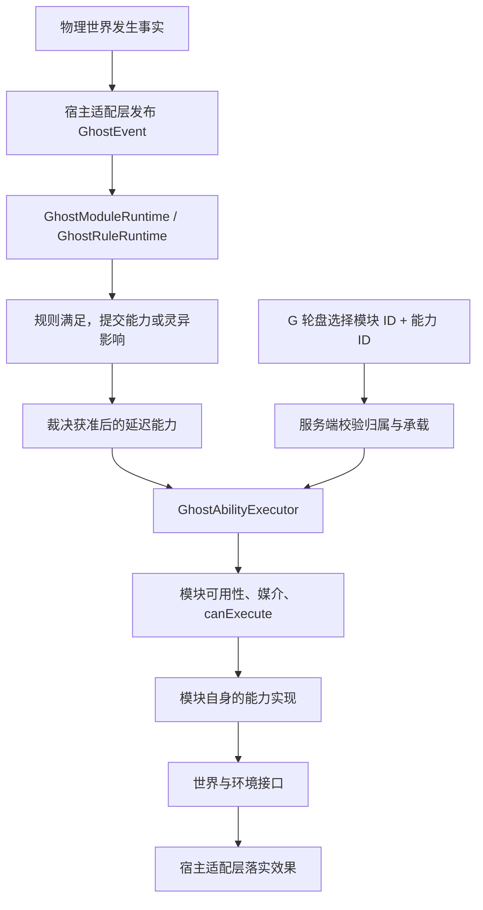

# 能力与媒介

[返回开发指南目录](../ghost-module-development.md)

## 当前能力定义与执行链

### 唯一能力列表

新模块覆盖 `getIntrinsicAbilities()`：

```java
@Override
public List<GhostAbility> getIntrinsicAbilities() {
    return List.of(new FirstAbility(), new SecondAbility());
}
```

当前 `getAbilities()` 默认返回该列表的不可变副本。开发新模块不应另外覆盖它来维护第二份技能目录。

以下旧机制已经移除，不要重新引入：

- `getActiveAbilities()` 与主动技能白名单。
- `manuallySelectable()` 过滤。
- `GhostActiveAction` 预设技能枚举。
- `WorldActionAbility` 与集中式动作分发。
- 每个模块自动附加的 `player_action`。

**默认能力是公开技能；私有能力仍保留定义，但不进入玩家技能目录。** 目录收集玩家已经驾驭、满足承载条件的模块。未配置时按实例保存顺序、能力声明顺序取前十项；H 面板第三页或 Alt＋G 可从完整目录拖动技能到十个固定槽位，因此超过十项的技能也可装备。

寻路更新、冷却递减、鬼域资源维护、持续代价计时等内部工作，不要仅为复用执行器而注册成技能。

### 一个能力需要定义什么

| 方法 | 当前默认值 / 用法 |
| --- | --- |
| `getId()` | 必须实现；模块内唯一且长期稳定 |
| `translationKey()` | `ability.<namespace>.<path>`，路径中的 `/` 替换为 `.` |
| `iconTexture()` | 默认原版下界之星；建议显式声明完整 PNG 路径 |
| `media(context)` | 默认空；能力自己的硬性媒介 |
| `inheritsModuleMedia()` | 默认 `true`；同时检查模块媒介 |
| `canExecute(context)` | 必须实现；只判断，不改变状态 |
| `execute(context)` | 必须实现；兼容无返回结果调用 |
| `executeWithResult(context)` | 默认调用 `execute()` 后返回 `true`；真实效果可能失败时应覆盖 |
| `getStimulation(context)` | 默认无复苏刺激；代价声明见[裁决与对抗](adjudication-combat.md) |

媒介组合方式：

```text
模块 getMedia(context)（仅在 inheritsModuleMedia 为 true 时）
    + 当前能力 media(context)
    → 所有媒介都通过
    → canExecute
    → 复苏刺激与效果执行
```

共享条件放模块媒介；某一个技能的条件放技能媒介。不要把“必须开着鬼域”写成整个模块的共用条件，导致“打开鬼域”自身无法使用。

`inheritsModuleMedia() == false` 是完全替换模块共用媒介，不是忽略所有条件。使用它时必须说明为什么这个技能不适用模块共用条件，并完整声明自己的前提。

### 两种实现写法

复杂技能推荐普通类或匿名 `GhostAbility`，便于分别声明媒介、代价和成功结果。

简单技能可以使用 `DefinedGhostAbility`：

```java
new DefinedGhostAbility(
        ResourceLocation.fromNamespaceAndPath("qisplan2", "example/domain_up"),
        ResourceLocation.parse("minecraft:textures/item/glowstone_dust.png"),
        c -> c.getModuleContext().world().domain().exists()
                && c.getModuleContext().world().domain().layer() < 6,
        c -> c.getModuleContext().world().domain().setLayer(
                c.getModuleContext().world().domain().layer() + 1)
)
```

需要导入 `DefinedGhostAbility` 和 `ResourceLocation`。这是用法片段，不是需要新增的全局注册项。

该 record 仅保存模块传入的条件和效果函数，没有预设技能、技能 ID 分发或宿主分支。它仍继承模块媒介；需要自定义刺激或能力专属媒介时，改用普通 `GhostAbility`。

### 实际执行流程



规则和轮盘最终调用的是同一个能力 ID、同一份实现。轮盘不会自动生成 `TouchEvent`、`DoorChangedEvent` 或“受到袭击”事实。

### 状态限制的准确含义

`RULE`、`BEHAVIOR` 要求模块满足 `GhostModuleCombatState.available()`；承载失败、沉睡、死机等会使其不可用。

当前 `GhostAbilityContext.isModuleAvailable()` 对 `POSSESSION` 的实现，是检查模块存在且可承载，然后绕过整个 `available()` 检查。因此当前代码不只是绕过裁决死机，也绕过该检查包含的沉睡和裁决死机状态。若未来要单独限制主动调用时的沉睡行为，需要修改统一策略，不能在各技能里悄悄添加宿主分支。

这不意味着主动技能无条件成功：媒介、目标资格、能力条件、世界接口支持范围仍然有效。

### 通用鬼域快捷键

能力可通过 `domainShortcut()` 声明可选的 `GhostDomainShortcut` 输入语义；`DefinedGhostAbility` 的第五个构造参数可直接传入该声明，原四参数构造不绑定快捷键。该枚举仅用于选择能力，不定义技能效果，也不要求模块认识玩家宿主。

默认键：化虹 R，目标升降层 Page Up / Page Down，自身升降层 ↑ / ↓，总层数升降 小键盘＋ / －。均可在按键设置中重绑。输入桥从已驾驭、可承载且鬼域已开启的能力中选择匹配项；多个模块匹配时按模块保存顺序取第一个。只声明自己支持的操作（目前鬼眼七项，鬼雾为化虹及目标升降层三项）。

快捷键与轮盘发送相同的 `GhostAbilityUsePayload`，共用服务端归属检查、媒介和效果执行。界面打开、失焦、死亡或旁观时不触发快捷能力，轮盘中的能力仍保留。

### 私有能力与持续能力

`GhostAbility.isPublicSkill()` 默认返回 `true`。覆盖为 `false` 后，该能力仍能由规则、行为及可信的持续流程调用，但不会显示在技能目录、轮盘和快捷键中。服务端目录校验与 `GhostAbilityExecutor` 同时拒绝直接 `POSSESSION` 调用私有能力，不能只隐藏 UI。

```java
/** 只能由真实语义事件触发，不可单独作为技能。 */
@Override public boolean isPublicSkill() { return false; }
```

私有不等于没有媒介。敲门袭击必须收到 `DoorKnockHeardEvent`；钢琴袭击必须收到真正的音乐中断事件；喊名袭击必须是已听到喊名的当前目标完成回头。不得为私有能力保留自由瞄准的替代目标。

持续能力把运行状态保存到模块 `customData`。公开开始技能写入状态；模块显式声明 `ticksAbilities() == true` 后，`tickAbilities(context)` 才会推进已启动过程；通过 `abilityEventTypes()` 声明类型后，`onAbilityEvent(context, event)` 才接收对应事实。通过 `context.continueAbility(...)` 使用内部 `CONTINUATION` 来源，仍经过媒介、条件、刺激与主动影响裁决。生命周期不是自动规则，不应用来无条件开启能力，网络不能指定该来源。规则死机不会终止玩家已经主动启动且仍满足媒介的能力。

当前对应关系：

| 模块 | 公开技能 | 私有能力 |
| --- | --- | --- |
| 敲门鬼 | 敲门 | 听声后的袭击 |
| 鬼钢琴 | 播放／停止灵异音乐 | 中断袭击 |
| 鬼石砖 | 无 | 摧毁反击 |
| 喊人鬼 | 持续喊名／取消跟踪（空放也取消） | 来源进入目标视野后的袭击 |
| 红／白鬼烛 | 点燃／熄灭 | 持续吸引／屏蔽 |
| 鬼地毯、鬼草丛、鬼雾 | 保留接触袭击、侵蚀等主动能力 | 不因“袭击”名称批量私有化 |

钢琴在自主且未死机、未沉睡时默认播放，已驾驭来源默认不播放；显式播放／停止保存在 `musicPlaying`、`manualMusic`。声源通过统一适配器注册，传播中断继续发布原有语义事实。

喊名启动时固定目标初始水平朝向对应的后方偏移；来源只随目标位置平移，不随转头绕到另一侧。每 100 tick 喊名一次，转动预算逐次为 70°、140°、180°（封顶），每 tick 速度从 6° 逐次增加至 12°。实际转向朝来源位置计算，包含俯仰并避免越过。转动前后立即检查：来源进入前方 120° 视锥且无遮挡才触发私有袭击，不再使用累计 165° 阈值。空放喊名或取消跟踪技能会清空目标和牵引状态，取消不要求追踪媒介。无听力标签阻止强制转头，但目标主动看见来源仍可触发袭击。

鬼烛模块只请求燃烧状态和连续消耗，载体适配器决定代价：可损耗物品扣耐久，普通生命来源（含玩家）永久扣最大生命并显示原版着火状态，模块化厉鬼实体只显示火焰而不支付此项代价。基础速率沿用 0.05／tick（1／秒），附近厉鬼和屏蔽声音可加快消耗；最大生命不足支付且至少保留 1 点时自动熄灭。没有耐久的物品与方块仍使用模块存储燃料。停止燃烧立刻移除环境效果。

### 主动输入

当前轮盘发送 `GhostAbilityUsePayload(moduleId, abilityId)`。服务端重新校验玩家、归属、承载和目录，再构造 `POSSESSION` 上下文，事件为 `null`，参数为服务端提供的 `GhostInvocationParameters(player)`。

因此新能力要明确处理：

1. 自动规则的事实目标在哪里？
2. 主动调用怎样取得目标？
3. 输入对象为空、离开范围、跨世界或已死亡时如何失败？
4. 延迟执行时是否仍能通过媒介？

常用主动目标出口为 `world.aimedTarget(range)`、`world.aimedBlock(range)`；当前实现对范围有上限，不能假定任意大数有效。

更复杂的能力可以新增实现 `GhostAbilityParameters` 的参数 record，由可信输入适配器构造。不要把整份宿主对象塞进参数。当前轮盘没有通用多阶段选目标、文本输入或任意参数序列化界面；需要这类操作时必须扩展通用输入流程，不能假装声明了能力就已经支持。

### 外部调用能力的正确方式

以下片段属于宿主/输入适配层，**不放进模块定义**：

```java
var invocation = new GhostAbilityContext(
        host,
        ContactEchoModule.ID,
        ContactEchoModule.ATTACK,
        GhostAbilityContext.Source.POSSESSION,
        null,
        () -> {},
        new GhostTargetParameters(target)
);
boolean success = GhostAbilityExecutor.tryExecuteWithResult(invocation);
```

调用者必须先确认 `host` 携带已注册的模块；构造器会校验模块和能力 ID，不能把异常当作普通校验返回值。

不要直接 `ability.execute(context)`，否则会绕过统一媒介、状态和刺激结算。
